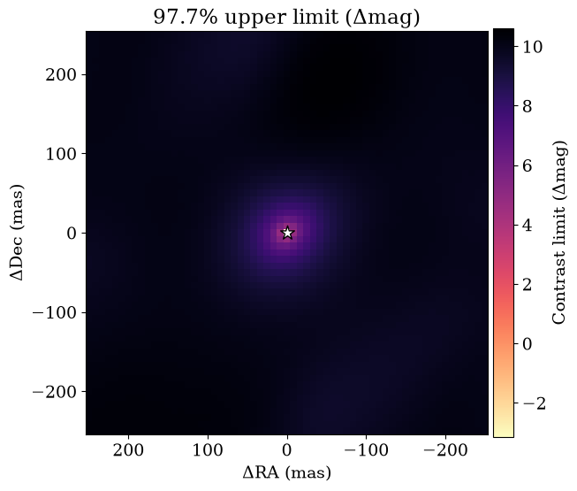
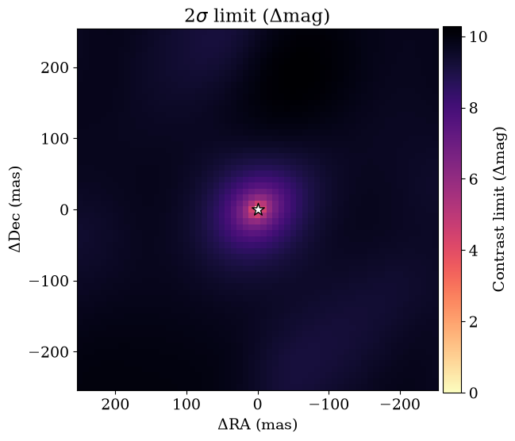
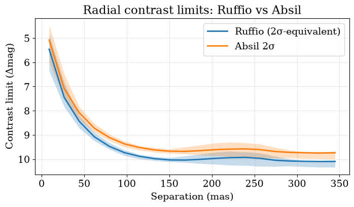
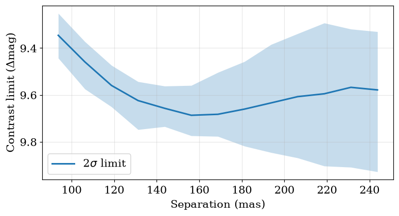

<!-- AUTO-GENERATED FROM notebooks/contrast_limits.ipynb by scripts/sync_tutorial_docs.py. -->
# Contrast limits with Ruffio method

> **Install:** the "As a pipeline" section needs the `pipeline` extra: `pip install "virgil-astro[pipeline]"`.

You have a non-detection, or you have subtracted a well-measured companion and want to know whether anything *else* is in the data. What could you have detected?

This tutorial applies the two methods common in interferometry to a non-detection:

- the Bayesian [Ruffio method](https://ui.adsabs.harvard.edu/abs/2018AJ....156..196R/abstract), which finds the Laplace-approximation posterior for a point-source companion's flux at every grid position and quotes a posterior Nσ upper limit;
- the frequentist [Absil method](https://ui.adsabs.harvard.edu/abs/2011A%26A...535A..68A/abstract), which uses $\chi^2$ statistics to set an upper limit at a chosen confidence.

First, the imports.

??? note "Imports and setup"

    ```python
    import sys
    from pathlib import Path

    import jax.numpy as jnp
    import numpy as onp
    import jax.scipy as jsp
    import matplotlib.pyplot as plt

    repo_root = Path.cwd()
    if not (repo_root / "src").exists():
        repo_root = repo_root.parent
    src_path = repo_root / "src"
    if str(src_path) not in sys.path:
        sys.path.insert(0, str(src_path))

    from virgil.grid_fit import laplace_flux_uncertainty_grid, optimized_flux_grid
    from virgil.limits import absil_limits, flux_to_delta_mag, ruffio_upperlimit
    from virgil.models import BinaryModelCartesian
    from virgil.oidata import OIData
    from virgil.plotting import plot_contrast_curve, plot_grid_map, set_style

    set_style()  # the figure style used throughout the docs
    ```

```text
auto.py:21: TqdmWarning: IProgress not found. Please update jupyter and ipywidgets. See https://ipywidgets.readthedocs.io/en/stable/user_install.html
  from .autonotebook import tqdm as notebook_tqdm
```

## Simulate Data

We generate pure-noise data with Fourier sampling similar to the JWST AMI mask.

```python
rng = onp.random.default_rng(7)

oidata = OIData(repo_root / "data" / "NuHor_F480M.oifits")

# Pure-noise injection amplitude (1.0 uses nominal OIData uncertainties).
noise_amp = 1.0

sim_data = {
    "u": oidata.u,
    "v": oidata.v,
    "wavel": oidata.wavel,
    "vis": jnp.ones_like(oidata.vis)
    + noise_amp * jnp.array(rng.normal(size=oidata.vis.shape)) * oidata.d_vis,
    "d_vis": oidata.d_vis,
    "phi": noise_amp
    * jnp.array(rng.normal(size=oidata.phi.shape))
    * oidata.d_phi,
    "d_phi": oidata.d_phi,
    "i_cps1": oidata.i_cps1,
    "i_cps2": oidata.i_cps2,
    "i_cps3": oidata.i_cps3,
    "v2_flag": oidata.v2_flag,
    "cp_flag": oidata.cp_flag,
}

oidata_sim = OIData(sim_data)

print(
    "Noise amplitude: {:.2g}, Vis std: {:.2g}, Phi std: {:.2g}".format(
        noise_amp,
        float(jnp.std(sim_data["vis"] - 1.0)),
        float(jnp.std(sim_data["phi"])),
    )
)
```

```text
Noise amplitude: 1, Vis std: 0.00033, Phi std: 0.00028
```

## Declare a search grid

Next, declare the search grid. It sets the flux level in each pixel about which we expand the posterior or build confidence intervals.

```python
samples = {
    "dra": jnp.linspace(-250.0, 250.0, 61),
    "ddec": jnp.linspace(-250.0, 250.0, 61),
    "flux": 10 ** jnp.linspace(-5.0, -1.5, 50),
}

# Best-fit companion/primary flux at every (dra, ddec).
opt_flux = optimized_flux_grid(BinaryModelCartesian, oidata_sim, samples)
```

## Ruffio Contrast Limits

The [Ruffio et al 2018](https://ui.adsabs.harvard.edu/abs/2018AJ....156..196R/abstract) method is Bayesian: infer the Gaussian posterior on a companion's flux, impose a positive-flux prior, and report a chosen percentile as the upper limit, *conditioned on the astrometry being right and a source being there*.

```python
sigma_flux = laplace_flux_uncertainty_grid(
    BinaryModelCartesian, oidata_sim, samples, flux=opt_flux
)

# Ruffio method at the 2σ-equivalent percentile
perc = jsp.stats.norm.cdf(2.0)
ruffio_map = ruffio_upperlimit(opt_flux, sigma_flux, perc)

plot_grid_map(
    ruffio_map, samples, kind="limit", units="delta_mag", percentile=perc
);
```



## Absil Contrast Limits

[Absil et al 2011](https://ui.adsabs.harvard.edu/abs/2011A%26A...535A..68A/abstract) use a frequentist chi-squared test: the limit is the faintest companion that would have been detected at n-σ.

```python
# Absil method at 2σ
absil_map = absil_limits(BinaryModelCartesian, oidata_sim, samples, sigma=2.0)

{
    "opt_flux_finite_frac": float(jnp.mean(jnp.isfinite(opt_flux))),
    "sigma_flux_finite_frac": float(jnp.mean(jnp.isfinite(sigma_flux))),
    "ruffio_finite_frac": float(jnp.mean(jnp.isfinite(ruffio_map))),
    "absil_finite_frac": float(jnp.mean(jnp.isfinite(absil_map))),
    "ruffio_median_dmag": float(jnp.nanmedian(flux_to_delta_mag(ruffio_map))),
    "absil_median_dmag": float(jnp.nanmedian(flux_to_delta_mag(absil_map))),
}

plot_grid_map(absil_map, samples, kind="limit", units="delta_mag", sigma=2.0);
```

```text
RuntimeWarning: absil_limits(): 1 limits fell outside flux_bounds=(1e-06, 1.0) and were clipped to the nearer bound; pass wider flux_bounds, or None, to search further.
```



## Contrast Curves
Plotted as contrast curves on one axis, the two methods give similar but not identical limits.

The limits are companion/primary flux ratios, but astronomers report a contrast (primary/companion) or magnitudes: a companion 100 times fainter than the star has a contrast of 100, or 5 mag. `units="delta_mag"` (the default for curves) or `units="contrast"` converts for display, and `flux_to_delta_mag` / `flux_to_contrast` convert the numbers.

Contrast limits say which companions a non-detection rules out at each position. To calibrate a detection threshold against simulated noise, including the look-elsewhere effect of a grid search, and to measure completeness at a fixed false-alarm probability, see [Detection ROC curves](detection_roc.md).

```python
# Overplot Ruffio and Absil radial contrast curves on one axis
fig, ax = plt.subplots(figsize=(8, 4))
plot_contrast_curve(ruffio_map, samples, label="Ruffio (2σ-equivalent)", ax=ax)
plot_contrast_curve(absil_map, samples, label="Absil 2σ", ax=ax)
ax.set_title("Radial contrast limits: Ruffio vs Absil");
```



## As a pipeline

The search grid, Absil limits and contrast curve are the `search` and `limits` stages of [`BinaryPipeline`](pipeline.md), so running it `through="limits"` stops before the fit and sampler, which a non-detection does not need. The cell below uses the same $\pm 250$ mas grid of 61 points per axis, the same flux axis and $\sigma = 2$. The pipeline blanks grid points inside the resolution limit, where separation and flux are degenerate, so compare its limit map with the hand-computed Absil map where both are defined. The contrast curve is one of the pipeline's plots.

```python
from tempfile import mkdtemp

from IPython.display import Image, display

from virgil.pipeline import BinaryPipeline

res = BinaryPipeline(
    oidata_sim,
    BinaryModelCartesian(dra=0.0, ddec=0.0, flux=1e-3),
    output=f"{mkdtemp()}/limits_run",
    sigma=2.0,
    max_sep_mas=250.0,
    grid_step_mas=8.34,  # 61 points from -250 to 250 mas
    flux_range=[1e-5, 10**-1.5],
    n_flux=50,
).run(through="limits")
print(res.describe())
display(Image(filename=str(res.path / "plots" / "limits_contrast_curve.png")))
```

```text
BinaryPipeline run in /var/folders/19/fbthdtcx20d3xyc7y7vp_2v40000gn/T/tmpk6xqpibo/limits_run: partial
  data.n_vis = 21
  data.n_phi = 35
  data.n_independent = 36
  data.wavel_min_m = 4.817e-06
  data.wavel_max_m = 4.817e-06
  data.baseline_min_m = 1.32
  data.baseline_max_m = 5.28001
  data.resolution_mas = 94.0887
  data.fov_mas = 752.71
  chi2.n_independent = 36
  chi2.null_reduced = 0.614164
  search.delta_chi2 = 7.05621
  search.log_bayes_factor = -0.349728
  search.max_snr = 2.65709
  search.local_nsigma = 2.65635
  search.global_nsigma = 1.19582
  search.false_alarm_probability = 0.115884
  search.n_null = 1000
  search.n_null_above = 115
  search.dra_mas = -100
  search.ddec_mas = -175
  search.flux = 8.28444e-05
  search.max_sep_mas = 250
  limits.sigma = 2
  limits.deepest_delta_mag = 9.6868
  [pass] chi2: χ²/N = 0.614 for the star alone on quoted errors: consistent with the quoted errors.
  [warn] detection: No companion above 3σ (2.66σ local): the fit and posterior describe the highest noise peak; quote the contrast limits instead.
  [pass] grid_edge: The grid peak lies inside the searched grid.
  [warn] limits_clipped: 1 limits fell outside the flux bounds and were clipped to the nearer bound: those limits are not the true limits; widen flux_range.
  1 warning(s) recorded in the limits stage(s) (see the checks, or Result.summary['warnings'])
```


