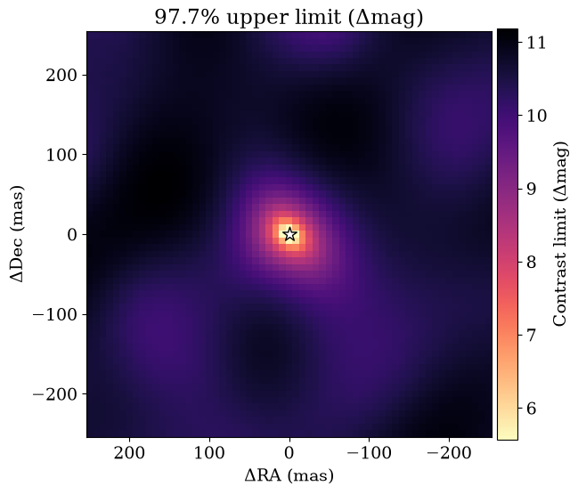
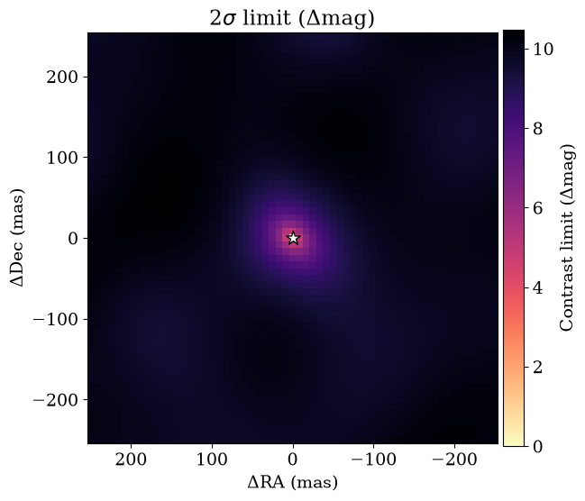
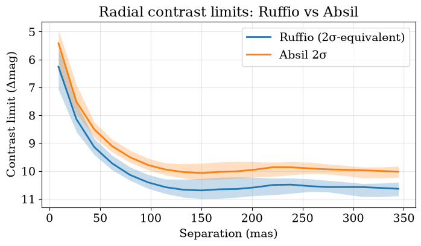
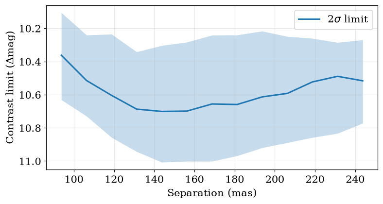

<!-- AUTO-GENERATED FROM notebooks/contrast_limits.ipynb by scripts/sync_tutorial_docs.py. -->
# Contrast limits with Ruffio method

> **Install:** the "As a pipeline" section needs the `pipeline` extra: `pip install "virgil-astro[pipeline]"`.

You have a non-detection, or you have subtracted a well-measured companion and want to know whether anything *else* is in the data. What could you have detected?

This tutorial applies the two methods common in interferometry to a non-detection:

- the Bayesian [Ruffio method](https://ui.adsabs.harvard.edu/abs/2018AJ....156..196R/abstract), which finds the Laplace-approximation posterior for a point-source companion's flux at every grid position and quotes a posterior Nσ upper limit;
- the frequentist [Absil method](https://ui.adsabs.harvard.edu/abs/2011A%26A...535A..68A/abstract), which uses $\chi^2$ statistics to set an upper limit at a chosen confidence.

First, the imports.

??? note "Imports and setup"

    ```python
    import shutil

    import jax
    import jax.numpy as jnp
    import numpy as onp
    import jax.scipy as jsp
    import matplotlib.pyplot as plt

    from virgil.coverage import nrm_oidata
    from virgil.grid_fit import laplace_flux_uncertainty_grid, optimized_flux_grid
    from virgil.limits import absil_limits, flux_to_delta_mag, ruffio_upperlimit
    from virgil.models import BinaryModelCartesian
    from virgil.plotting import plot_contrast_curve, plot_grid_map, set_style

    set_style()  # the figure style used throughout the docs
    shutil.rmtree("limits_run", ignore_errors=True)  # the pipeline section writes here
    ```

## Simulate Data

We generate pure-noise data with the Fourier sampling of the JWST AMI mask: [`nrm_oidata`](api/coverage.md) gives the 21 squared visibilities and 35 closure phases of its seven holes at 4.8 microns, with zero data and chosen errors, and `with_model` fills them from a model plus noise. The model is a lone star, a binary with no flux in the companion.

```python
oidata_sim = nrm_oidata(
    wavelength_m=4.817e-6, sigma_v2=3.3e-4, sigma_cp_deg=0.016
).with_model(
    BinaryModelCartesian(dra=0.0, ddec=0.0, flux=0.0), key=jax.random.PRNGKey(7)
)
print(oidata_sim.vis.size, "squared visibilities and", oidata_sim.phi.size, "closure phases")
```

```text
21 squared visibilities and 35 closure phases
```

## Declare a search grid

Next, declare the search grid. It sets the flux level in each pixel about which we expand the posterior or build confidence intervals.

```python
samples = {
    "dra": jnp.linspace(-250.0, 250.0, 61),
    "ddec": jnp.linspace(-250.0, 250.0, 61),
    "flux": 10 ** jnp.linspace(-5.0, -1.5, 50),
}

# Best-fit companion/primary flux at every (dra, ddec).
opt_flux = optimized_flux_grid(BinaryModelCartesian, oidata_sim, samples)
```

```text
RuntimeWarning: optimized_flux_grid(): the optimizer did not converge at 160 of 3721 grid positions; values there may be inaccurate.
```

`optimized_flux_grid` warns where its optimizer did not converge (here at a few per cent of the grid points), because the best-fit flux, and so the limit, may be inaccurate there; the warning is the function telling you where.

## Ruffio Contrast Limits

The [Ruffio et al 2018](https://ui.adsabs.harvard.edu/abs/2018AJ....156..196R/abstract) method is Bayesian: infer the Gaussian posterior on a companion's flux, impose a positive-flux prior, and report a chosen percentile as the upper limit, *conditioned on the astrometry being right and a source being there*.

```python
sigma_flux = laplace_flux_uncertainty_grid(
    BinaryModelCartesian, oidata_sim, samples, flux=opt_flux
)

# Ruffio method at the 2σ-equivalent percentile
perc = jsp.stats.norm.cdf(2.0)
ruffio_map = ruffio_upperlimit(opt_flux, sigma_flux, perc)

plot_grid_map(
    ruffio_map, samples, kind="limit", units="delta_mag", percentile=perc
);
```



## Absil Contrast Limits

[Absil et al 2011](https://ui.adsabs.harvard.edu/abs/2011A%26A...535A..68A/abstract) use a frequentist chi-squared test: the limit is the faintest companion that would have been detected at n-σ.

```python
# Absil method at 2σ
absil_map = absil_limits(
    BinaryModelCartesian, oidata_sim, samples, sigma=2.0, flux_bounds=(1e-8, 1.0)
)

plot_grid_map(absil_map, samples, kind="limit", units="delta_mag", sigma=2.0);
```

```text
RuntimeWarning: absil_limits(): 1 limits fell outside flux_bounds=(1e-08, 1.0) and were clipped to the nearer bound; pass wider flux_bounds, or None, to search further.
```



## Contrast Curves
`absil_limits` warns that one limit fell outside `flux_bounds` and was clipped to the nearer bound; it is a single pixel of the map. Plotted as contrast curves on one axis, the two methods give similar but not identical limits.

The limits are companion/primary flux ratios, but astronomers report a contrast (primary/companion) or magnitudes: a companion 100 times fainter than the star has a contrast of 100, or 5 mag. `units="delta_mag"` (the default for curves) or `units="contrast"` converts for display, and `flux_to_delta_mag` / `flux_to_contrast` convert the numbers.

Contrast limits say which companions a non-detection rules out at each position. To calibrate a detection threshold against simulated noise, including the look-elsewhere effect of a grid search, and to measure completeness at a fixed false-alarm probability, see [Detection ROC curves](detection_roc.md).

```python
# Overplot Ruffio and Absil radial contrast curves on one axis
fig, ax = plt.subplots(figsize=(8, 4))
plot_contrast_curve(ruffio_map, samples, label="Ruffio (2σ-equivalent)", ax=ax)
plot_contrast_curve(absil_map, samples, label="Absil 2σ", ax=ax)
ax.set_title("Radial contrast limits: Ruffio vs Absil");
```



## As a pipeline

The search grid, Ruffio limits and contrast curve are the `search` and `limits` stages of [`BinaryPipeline`](pipeline.md), so running it `through="limits"` stops before the fit and sampler, which a non-detection does not need. The cell below uses the same $\pm 250$ mas grid of 61 points per axis, the same flux axis and $\sigma = 2$. The pipeline blanks grid points inside the resolution limit, where separation and flux are degenerate, so compare its limit map with the hand-computed Ruffio map where both are defined; `limit_method="absil"` gives the Absil map instead. The contrast curve is one of the pipeline's plots. A non-detection is the expected outcome here, so the `detection` check warns that no companion exceeds 3σ; the `convergence` and `stage_warnings` warnings count grid positions where the flux refinement did not converge, as in the warning above; `res.describe()` prints the full report.

```python
from IPython.display import Image, display

from virgil.pipeline import BinaryPipeline

res = BinaryPipeline(
    oidata_sim,
    BinaryModelCartesian(dra=0.0, ddec=0.0, flux=1e-3),
    output="limits_run",
    sigma=2.0,
    max_sep_mas=250.0,
    grid_step_mas=8.34,  # 61 points from -250 to 250 mas
    flux_range=[1e-5, 10**-1.5],
    n_flux=50,
).run(through="limits")
s = res.summary
print(f"chi2/N of the star alone: {s['chi2']['null_reduced']:.2f}; "
      f"best grid point {s['search']['local_nsigma']:.1f} sigma (local)")
print(f"deepest 2-sigma limit: {s['limits']['deepest_delta_mag']:.1f} mag")
print({c.name: c.status for c in res.checks if c.status != "pass"})
display(Image(filename=str(res.path / "plots" / "limits_contrast_curve.png")))
```

```text
chi2/N of the star alone: 1.05; best grid point 1.9 sigma (local)
deepest 2-sigma limit: 10.7 mag
{'detection': 'warn', 'convergence': 'warn', 'stage_warnings': 'warn'}
```


