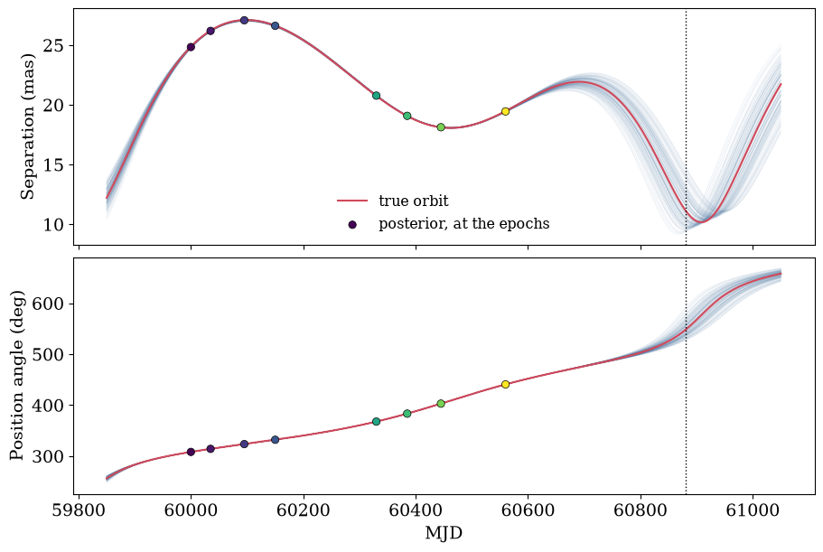
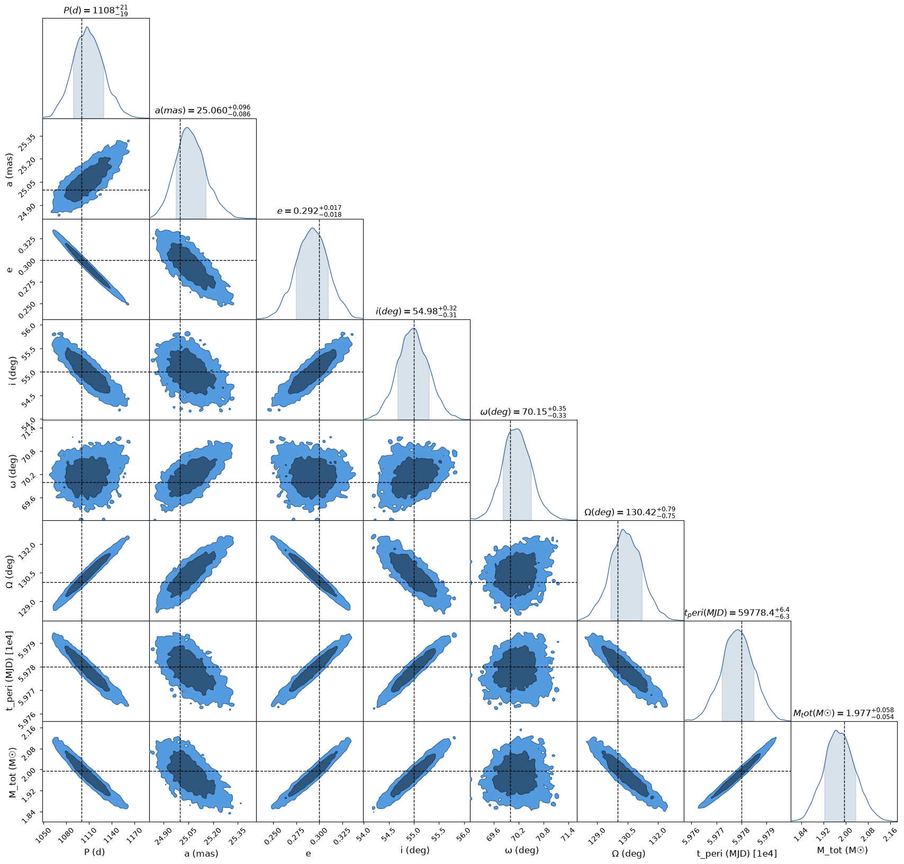

<!-- AUTO-GENERATED FROM notebooks/orbit_fitting.ipynb by scripts/sync_tutorial_docs.py. -->
# Fitting a binary's orbit to interferometric data

!!! warning "Provisional"
    May change in any 0.4.x release without a deprecation cycle.

> **Install:** this tutorial needs the `orbits`, `plots` and `pipeline` extras: `pip install "virgil-astro[orbits,plots,pipeline]"`.

A resolved binary observed again over weeks and years shows the companion moving around its primary. `OrbitPipeline` turns a set of OIFITS files, one or more per night, into a Keplerian orbit **without being told the period**. The nights are often far apart, so many orbit counts fit the positions almost equally well (period aliases), and the pipeline's job is to weigh them with all the interferometric data and sample the survivor. No published period, window, starting orbit or prior is used anywhere: a published orbit may be compared with the result afterwards, never fed into the fit.

**What you'll get.** One call, a run folder, and the orbit recovered from two observing seasons 238 days apart for a binary with a 12.4 day period:



*Orbits drawn from the posterior (blue) around the true orbit (red). The markers are the companion's positions at the eight nights, fitted from each night alone, coloured by time.*

The page has four parts:

1. **Simulate** eight nights of VLTI-like data whose quoted errors are too small by a different factor each night, as real ones are, and write them as OIFITS files.
2. **One call**: `OrbitPipeline.from_oifits(files).run()`, then read the result: the raw χ²/N, the quality checks, the orbit and the alias bands.
3. **The engine underneath**: the functions the pipeline calls (`epoch_positions`, `fit_orbit_aliases`, tempering), for when you need control.
4. **How the engine decides**, and why its defaults are what they are.

`OrbitPipeline` fits data that an instrument package has already prepared: the channel, band edges, outlier exposures and noise model are the instrument package's job (for the VLTI instruments, [virgil-vlti](https://github.com/benjaminpope/virgil-vlti)), not the pipeline's. It has no instrument-specific settings, so this page applies to any instrument. The orbit conventions are those of [Conventions](conventions.md#orbits): `Omega` is the position angle of the node where the secondary recedes, `omega` is the secondary's argument of periastron, an inclination below 90° means the position angle increases with time, and times are days since a reference epoch `t_ref`.

## The system

The binary has a period of 12.38 days, a mildly eccentric orbit ($e = 0.3$), a semimajor axis of 10 mas and an inclination of 50°; the companion is 0.3 times as bright as the primary in the K band. It is observed on eight nights in two seasons, four nights early in 2023 and four about 238 days later. Between the seasons the companion completes about twenty orbits, so the period is aliased: the positions of the second season fit every period whose cycle count differs from the true one by a whole number. Each night has three snapshots 30 minutes apart, so the companion is a static point within a night to good accuracy, as the pipeline assumes.

??? note "Imports and setup"

    ```python
    import warnings

    warnings.filterwarnings("ignore", message="IProgress not found.*")
    warnings.filterwarnings("ignore", category=SyntaxWarning)

    from pathlib import Path
    from tempfile import TemporaryDirectory

    import equinox as eqx
    import jax
    import matplotlib.pyplot as plt
    import numpy as np
    from IPython.display import Image

    from virgil.aliases import fit_orbit_aliases
    from virgil.coverage import vlti_oidata
    from virgil.epochs import epoch_positions
    from virgil.likelihood import whitened_residuals
    from virgil.models import Attached, PointSource, System
    from virgil.oifits import write_oifits
    from virgil.orbits import KeplerOrbit
    from virgil.pipeline import OrbitPipeline
    from virgil.plotting import plot_orbit_ensemble, set_style
    from virgil.simulate import simulate

    jax.config.update("jax_enable_x64", True)
    set_style()
    ```

```python
T_REF = 60000.0  # MJD of the reference epoch of the true orbit
FLUX = 0.3  # companion / primary
TRUTH = dict(
    period=12.38,
    dt_peri=2.0,
    ecc=0.3,
    inc=50.0,
    omega=60.0,
    Omega=120.0,
    a_mas=10.0,
)
truth_orbit = KeplerOrbit(**TRUTH, t_ref=T_REF)
NIGHTS = T_REF + np.array([0.0, 2.4, 5.1, 9.4, 238.0, 240.6, 247.4, 251.0])
N_EPOCHS = len(NIGHTS)

print(
    f"period {TRUTH['period']} d; the {np.ptp(NIGHTS):.0f} d between the "
    f"first and last night are {np.ptp(NIGHTS) / TRUTH['period']:.1f} orbits"
)
```

```text
period 12.38 d; the 251 d between the first and last night are 20.3 orbits
```

## Simulating the observations

[`vlti_oidata`](api/coverage.md) builds the coverage of the four 8-m Unit Telescopes at Paranal for a target at declination −30°: three snapshots per night, each with all six baselines and four closure triangles, in six K-band channels (2.0–2.4 μm). The quoted errors are 0.05 on each $V^2$ and 3° on each closure phase.

Real calibrated errors are usually too small, by a factor that changes from night to night with the seeing and the calibrators, and differently for $V^2$ and closure phases. We mimic this: each night's true scatter is its quoted error times a factor drawn from a log-normal population (median 1.3, spread 0.3 in the natural log), separately for $V^2$ and closure phases, while the data keep the quoted errors. The scene is a primary point source and a companion [`Attached`](api/models/index.md) to the true orbit, so [`simulate`](api/simulate.md) places the companion at the time of every sample.

```python
# The first seed from 0 whose true-model chi2/N is within two standard errors of
# (error factor)^2 on every night, for both V^2 and closure phases.
SEED = 0
rng = np.random.default_rng(SEED)
TRUE_V2_SCALE = 1.3 * np.exp(0.3 * rng.standard_normal(N_EPOCHS))
TRUE_CP_SCALE = 1.3 * np.exp(0.3 * rng.standard_normal(N_EPOCHS))

template = vlti_oidata(
    declination_deg=-30.0,
    hour_angles_h=(-0.5, 0.0, 0.5),
    wavelengths_m=np.linspace(2.0e-6, 2.4e-6, 6),
    sigma_v2=0.05,
    sigma_cp_deg=3.0,
    nights_mjd=NIGHTS,
)
truth_scene = System(
    primary=PointSource(), comp=Attached(PointSource(FLUX), truth_orbit)
)
keys = jax.random.split(jax.random.PRNGKey(SEED), 2 * N_EPOCHS)
nights = []
for k, night in enumerate(template.split_by_epoch()):
    v2 = simulate(truth_scene, night, keys[2 * k], TRUE_V2_SCALE[k])
    cp = simulate(truth_scene, night, keys[2 * k + 1], TRUE_CP_SCALE[k])
    nights.append(eqx.tree_at(lambda d: d.phi, v2, cp.phi))
print(
    f"{len(nights)} nights, each with {nights[0].vis.size} V² and "
    f"{nights[0].phi.size} closure phases ({nights[0].n_independent} "
    "independent observables)"
)
```

```text
8 nights, each with 108 V² and 72 closure phases (162 independent observables)
```

The quoted errors are too small, as the data show: the reduced χ² of the *true* model against each night's data, on the quoted errors, is close to the square of that night's error factor, for $V^2$ and closure phases alike. (The seed is the first from 0 for which this holds to within two standard errors on every night; a single draw can stray, since a night's $\chi^2_r$ scatters by about $\sqrt{2/\nu}$, with $\nu$ its independent observables.) This raw χ²/N is the first number to look at for any fit; a fit that rescaled the errors until χ² came out near 1 would hide the problem.

```python
print("   MJD    χ²_r V²  (true factor²)   χ²_r CP  (true factor²)")
for k, night in enumerate(nights):
    w = np.asarray(whitened_residuals(truth_scene, night))
    n_vis = night.vis.size
    n_cp = night.n_independent - n_vis
    chi2_v2 = np.sum(w[:n_vis] ** 2) / n_vis
    chi2_cp = np.sum(w[n_vis:] ** 2) / n_cp
    print(
        f"{NIGHTS[k]:8.1f}  {chi2_v2:6.2f}   ({TRUE_V2_SCALE[k] ** 2:5.2f})"
        f"         {chi2_cp:6.2f}   ({TRUE_CP_SCALE[k] ** 2:5.2f})"
    )
```

```text
   MJD    χ²_r V²  (true factor²)   χ²_r CP  (true factor²)
```

```text
 60000.0    1.66   ( 1.82)           1.23   ( 1.11)
 60002.4    1.69   ( 1.56)           0.66   ( 0.79)
 60005.1    2.22   ( 2.48)           1.51   ( 1.16)
 60009.4    1.65   ( 1.80)           1.87   ( 1.73)
 60238.0    1.07   ( 1.23)           0.49   ( 0.42)
 60240.6    2.06   ( 2.10)           1.36   ( 1.48)
 60247.4    4.24   ( 3.70)           0.85   ( 0.80)
 60251.0    3.51   ( 2.98)           1.16   ( 1.09)
```

The left panel shows the uv coverage of the first night, coloured by wavelength. The right panel shows the true orbit on the sky (East to the left, North up) with the companion at each night, coloured by season.

```python
fig, (ax_uv, ax_sky) = plt.subplots(
    1, 2, figsize=(11, 4.6), constrained_layout=True
)
first = nights[0]
uu, vv = (np.asarray(x / first.wavel) / 1e6 for x in (first.u, first.v))
wavel_um = np.asarray(first.wavel) * 1e6
for sign in (1, -1):
    points = ax_uv.scatter(
        sign * uu, sign * vv, c=wavel_um, cmap="plasma", s=12
    )
fig.colorbar(points, ax=ax_uv, label="Wavelength (μm)")
ax_uv.set(
    xlabel="u (Mλ)",
    ylabel="v (Mλ)",
    aspect="equal",
    title=f"uv coverage on MJD {NIGHTS[0]:.0f}",
)
ax_uv.invert_xaxis()  # East to the left

track = T_REF + TRUTH["dt_peri"] + np.linspace(0, TRUTH["period"], 400)
dra, ddec, _ = truth_orbit.relative(track)
night_dra, night_ddec, _ = truth_orbit.relative(NIGHTS)
ax_sky.plot(dra, ddec, color="0.6", lw=1.2)
ax_sky.scatter(
    night_dra,
    night_ddec,
    c=NIGHTS,
    cmap="viridis",
    s=40,
    edgecolors="k",
    linewidths=0.5,
    zorder=3,
    label="nights",
)
ax_sky.plot(0, 0, "*", color="k", ms=14, label="primary")
ax_sky.set(
    xlabel="Δα (mas, East)",
    ylabel="Δδ (mas, North)",
    aspect="equal",
    title="True orbit",
)
ax_sky.invert_xaxis()
ax_sky.legend(frameon=False, fontsize="small")
plt.show()
```


## One call

Your data are OIFITS files, so we write the simulated nights to a temporary folder as one file per night. (This is only here because the simulated nights start as `OIData`; real files come from your instrument package.)

??? note "Code"

    ```python
    folder = TemporaryDirectory()
    files = []
    for k, night in enumerate(nights):
        files.append(str(Path(folder.name) / f"night{k}.oifits"))
        write_oifits(night, files[-1])
    print(f"wrote {len(files)} OIFITS files")
    ```

```text
wrote 8 OIFITS files
```

`OrbitPipeline.from_oifits` reads the files and groups them into nights at gaps of `gap_days` (half a day by default; override a file's night, or its time stamp, with `metadata`). Everything else has a default. The only settings below shorten the sampler, which by default is 4 chains of 1000 warm-up and 1000 draws, and skip the executed quicklook notebook, so the page stays quick:

```python
RUN = Path(folder.name) / "run"
pipeline = OrbitPipeline.from_oifits(
    files,
    output=RUN,
    num_warmup=500,
    num_samples=500,
    num_chains=2,
    quicklook_execute=False,
)
res = pipeline.run()
print(res.describe())
```

```text
OrbitPipeline run in /var/folders/19/fbthdtcx20d3xyc7y7vp_2v40000gn/T/tmpkby6gd0q/run: complete
  data.n_nights = 8
  data.n_datasets = 8
  data.n_vis = 864
  data.n_phi = 576
  data.n_independent = 1296
  data.span_days = 251
  data.wavel_min_m = 2e-06
  data.wavel_max_m = 2.4e-06
  data.baseline_min_m = 46.1298
  data.baseline_max_m = 130.092
  data.resolution_mas = 1.58553
  data.fov_mas = 10.7314
  chi2.n_independent = 1296
  chi2.best_orbit_reduced = 1.87211
  search.n_bands = 1
  search.t_ref = 60124.2
  search.span_days = 251
  search.primary_diam_estimate = 0
  orbit.n = 20
  posterior.num_chains = 2
  posterior.num_samples = 500
  posterior.num_warmup = 500
  posterior.r_hat_max = 1.00134
  posterior.ess_bulk_min = 495.583
  posterior.divergence_fraction = 0
  posterior.optimum_gap_max = 0
  [pass] chi2: χ²/N = 1.87 for the best-fit orbit on quoted errors: consistent with the quoted errors.
  [pass] night_flags: None of the 8 nights is flagged.
  [pass] labels_free: The labels of the stars are determined by the data.
  [pass] bands_failed: Every alias band was evaluated.
  [pass] alias_ambiguity: There is a single alias band: no rival period.
  [pass] winner_flags: The winning band's evidence has no flags.
  [warn] tempering: The effective-channel factor f = 1.31 (raw 1.18) is outside [0.5, 2] or the residual correlation is not AR(1): the evidences are less reliable.
  [pass] primary_resolved: The primary's size is not at the edge of the diameters tried.
  [pass] no_orbit: The best orbit beats a single star by 1.4e+03 nats: the orbit is clearly preferred.
  [pass] period_bound: The period is inside its window (1.37 to 1e+03 d).
  [pass] prior_bound: No posterior mass piles up at a prior bound.
  [pass] r_hat: Largest R-hat 1.0013: the chains agree.
  [pass] ess: Smallest bulk ESS 496: enough independent samples.
  [pass] divergences: Divergent transitions: 0 per cent: none.
  [pass] mode_converged: The search's best mode is an optimum of the sampled density.
  [warn] stage_warnings: 2 warning(s) were raised inside the stages: fit_orbit_aliases(): the period window starts at 1.37 d, 6.9 nights' length: a shorter period would move the companion by more than half the resolution during a night (field 8.33 mas). Pass p_range to search shorter periods.; fit_orbit_aliases(): the residual correlation of ['phi'] is flat across channels (lag-2 well above the square of lag-1), the signature of a shared calibration error or of misfit (a resolved primary, a moving companion). The likelihood is tempered by it either way; check the model (AliasResult.tempering).. See the 'warnings' list of summary.json.
  2 warning(s) recorded in the search stage(s) (see the checks, or Result.summary['warnings'])
```

## Reading the result

`describe()` prints the key numbers, led by the raw χ²/N of the best orbit on the quoted errors, and then the quality checks, in a fixed order, each with a status and a message. The summary is also a plain dictionary (`res.summary`, the file `summary.json` in the run folder) that a script or an agent can read without rerunning anything. First, the χ²/N of the best orbit on the quoted errors, night by night, against the truth we know here:

```python
chi2 = res.summary["chi2"]
print(
    f"best orbit: χ²/N = {chi2['best_orbit_reduced']:.2f} on the quoted "
    f"errors, N = {chi2['n_independent']}"
)
print("night       χ²/N   (true model)")
for (name, row), night in zip(chi2["nights"].items(), nights):
    w = np.asarray(whitened_residuals(truth_scene, night))
    true_chi2 = np.sum(w**2) / night.n_independent
    print(f"{name:9s} {row['chi2_per_n']:6.2f}   ({true_chi2:6.2f})")
```

```text
best orbit: χ²/N = 1.87 on the quoted errors, N = 1296
night       χ²/N   (true model)
mjd60000    1.48   (  1.52)
mjd60002    1.35   (  1.35)
mjd60005    1.97   (  1.99)
mjd60009    1.71   (  1.72)
mjd60238    0.81   (  0.88)
mjd60240    1.82   (  1.82)
mjd60247    3.13   (  3.11)
mjd60251    2.70   (  2.73)
```

A χ²/N of 1.87 passes the `chi2` check, which warns above 2 and fails above 5, yet the quoted errors here are too small by about $\sqrt{1.9}\approx1.4$, as simulated; the scale-marginalized score the engine fits absorbs that factor, and the raw χ²/N is how you see it. The checks say how far to trust the result. A check passes, warns or fails; none is silent about a problem, and `res.summary["worst_check"]` gives the worst status. Those that matter most for an orbit:

- `chi2`: the raw χ²/N of the best orbit.
- `night_flags`: nights that carry a flag. A blocking flag keeps a night from seeding an orbit; a non-blocking one (such as `sep-below-resolution`) is only reported. The data still count either way.
- `alias_ambiguity`: the log evidence of the best alias band over the runner-up's, in nats; under 10 nats the runner-up is not excluded.
- `tempering`: the correlated-channel factor of the likelihood is outside what it can trust.
- `no_orbit`: the best orbit against a single star.
- `r_hat`, `ess`, `divergences`: the sampler.

```python
for check in res.checks:
    print(f"[{check.status:4s}] {check.name:16s} {check.message[:100]}")
```

```text
[pass] chi2             χ²/N = 1.87 for the best-fit orbit on quoted errors: consistent with the quoted errors.
[pass] night_flags      None of the 8 nights is flagged.
[pass] labels_free      The labels of the stars are determined by the data.
[pass] bands_failed     Every alias band was evaluated.
[pass] alias_ambiguity  There is a single alias band: no rival period.
[pass] winner_flags     The winning band's evidence has no flags.
[warn] tempering        The effective-channel factor f = 1.31 (raw 1.18) is outside [0.5, 2] or the residual correlation is 
[pass] primary_resolved The primary's size is not at the edge of the diameters tried.
[pass] no_orbit         The best orbit beats a single star by 1.4e+03 nats: the orbit is clearly preferred.
[pass] period_bound     The period is inside its window (1.37 to 1e+03 d).
[pass] prior_bound      No posterior mass piles up at a prior bound.
[pass] r_hat            Largest R-hat 1.0013: the chains agree.
[pass] ess              Smallest bulk ESS 496: enough independent samples.
[pass] divergences      Divergent transitions: 0 per cent: none.
[pass] mode_converged   The search's best mode is an optimum of the sampled density.
[warn] stage_warnings   2 warning(s) were raised inside the stages: fit_orbit_aliases(): the period window starts at 1.37 d,
```

Two checks warn. The first, `stage_warnings`, has the search say how it chose its shortest period: a night is treated as a static snapshot, so periods short enough for the companion to move by more than half the resolution within a night are not searched (the window's lower end, 1.4 days here, is computed from the data; pass `period_range` to override it). The 12.4 day period is well inside the window. The second, `tempering`, is the search noticing that the residual closure-phase correlation across channels is flat, which can mean a shared calibration error or a misfit; the effective-channel factor $f = 1.31$ is itself inside its range. Here the data have no shared calibration error, but their error factors differ by a factor of two between nights and the companion moves during a night's three snapshots, which the per-night static position does not model, and either can look like one. It matters for how far to trust differences of evidence between alias bands; with one band here, the choice between bands is not at stake.

The winner's orbital elements come with 68% intervals from the posterior. The time of periastron is defined modulo the period, so we compare the passage nearest the true one.

```python
t_ref = res.summary["search"]["t_ref"]
elements = res.summary["orbit"]["elements"]
truth_t_peri = T_REF + TRUTH["dt_peri"]
t_peri = t_ref + elements["dt_peri"]["median"]
period = elements["period"]["median"]
wrap = (t_peri - truth_t_peri + period / 2) % period - period / 2
truths = {**TRUTH, "flux": FLUX, "dt_peri": TRUTH["dt_peri"] - wrap}
print(f"{'':8s}{'median':>12s}   68% interval            truth")
for name in ("period", "a_mas", "ecc", "inc", "omega", "Omega", "flux"):
    row = elements[name]
    print(
        f"{name:8s}{row['median']:12.4f}   "
        f"[{row['q16']:.4f}, {row['q84']:.4f}]   {truths[name]:10.4f}"
    )
q16, q84 = (elements["dt_peri"][k] - elements["dt_peri"]["median"] for k in ("q16", "q84"))
t_peri_near = truth_t_peri + wrap
print(
    f"{'t_peri':8s}{t_peri_near:12.3f}   "
    f"[{t_peri_near + q16:.3f}, {t_peri_near + q84:.3f}]   {truth_t_peri:10.3f}"
)
```

```text
              median   68% interval            truth
period       12.3799   [12.3797, 12.3801]      12.3800
a_mas        10.0081   [9.9869, 10.0277]      10.0000
ecc           0.2993   [0.2984, 0.3001]       0.3000
inc          49.9089   [49.7860, 50.0232]      50.0000
omega        59.8514   [59.6021, 60.1667]      60.0000
Omega       120.0860   [119.8990, 120.2714]     120.0000
flux          0.2999   [0.2978, 0.3020]       0.3000
t_peri     60001.997   [60001.994, 60002.001]    60002.000
```

A period of 12.38 days was found blind. The alias table shows what the search did: it lists one row per alias band, an integer number of orbits between the two seasons, with the band's log evidence, its probability and its flags. Here the short-arc step (see [below](#short-arcs-cycle-counts-from-the-motion)) rejected every other cycle count from the motion within and between the nights of each season before any band was fitted, so one band is left. With sparser nights several bands survive, and `alias_ambiguity` reports their margin.

```python
aliases = res.aliases()  # the engine's AliasResult, read back from the folder
print("band    n   period (d)  χ²/N     log Z     p  flags")
for row in aliases.table():
    print(
        f"{row['n']:11d} {row['period']:11.4f} {row['chi2_red']:6.2f} "
        f"{row['log_z']:9.1f} {row['p']:5.2f}  {row['flags']}"
    )
arcs = aliases.short_arc
print(
    f"the short arcs kept N = {arcs['kept']} and excluded "
    f"{len(arcs['excluded'])} other cycle counts"
)
```

```text
band    n   period (d)  χ²/N     log Z     p  flags
         20     12.3799   1.87   -2571.9  1.00  []
the short arcs kept N = [20] and excluded 183 other cycle counts
```

The run folder holds everything else. The posterior corner plot and the alias-band plot are written there, and every number in the summary comes from a public virgil function that you can call yourself (next section).

```python
plots = {Path(p).stem: p for p in res.plots}
print(sorted(plots))
Image(plots["search_bands"])
```

```text
['modes_sky', 'posterior_corner', 'posterior_trace', 'search_bands']
```


```python
Image(plots["posterior_corner"])
```



### The run folder and the command line

The run folder is the pipeline's output: `run.json` records the settings, the hash of every input file and the night it was assigned to, `summary.json` the numbers and checks, `stages/<name>/report.json` each stage, `samples.h5` the posterior, `plots/` the figures and `quicklook.ipynb` an executed notebook. An interrupted run resumes, refitting only the alias bands that are missing, and a changed setting or input file raises `ConfigMismatchError` rather than mixing old and new results. A later session reads a finished run without recomputing anything:

```python
res = load("runs/target")
res.summary["modes"]["winner"]     # the winning band
res.aliases().table()              # every band
res.samples()["period"]            # posterior draws, shape (chain, draw)
```

The same run from a shell: `virgil-pipeline orbit night*.oifits --output runs/target`, with `--set KEY=VALUE` for a setting and `--metadata FILE.json` for per-file rulings. The [pipelines page](pipeline.md#orbitpipeline-a-binary-seen-on-several-nights-provisional) lists the stages, settings and checks.

## The engine underneath

`OrbitPipeline` adds no science of its own. Its stages call public functions that you can call directly, with every argument open, when the pipeline's defaults are not what you need:

| Stage | The function it calls |
| --- | --- |
| `epochs` | [`epoch_positions`](api/epochs.md): each night's companion position on a grid, with the night's flags |
| `search` | [`fit_orbit_aliases`](api/aliases.md): the alias search, with the period window from the data, the label swap, flux flip, V² amplitude, primary diameter and tempering |
| `modes` | the best band against the others (`AliasResult`) and against a single star |
| `posterior` | NUTS on the engine's own density, in the winning band |

**Nightly positions and flags.** `epoch_positions` fits each night by a static binary on a grid of positions. The pipeline widens the grid until no night's best peak sits at its edge; here a fixed box is enough. Each night is scored with its error scales integrated out, so its `gap_marginal` (the best peak over every rival, in nats) does not depend on how well the quoted errors are calibrated. A night that cannot seed an orbit is flagged, with its reason, and still counts in every band's likelihood.

```python
epochs = pipeline.data  # the nights as an Epochs object
axis = np.linspace(-20.0, 20.0, 161)
found = epoch_positions(
    epochs,
    {"dra": axis, "ddec": axis, "flux": np.geomspace(0.05, 1.0, 13)},
)
true_dra, true_ddec, _ = (np.asarray(x) for x in truth_orbit.relative(epochs.times))
print("    MJD    fit Δα  true Δα    fit Δδ  true Δδ  flux  gap_marginal  flags")
for k, t in enumerate(epochs.times):
    print(
        f"{t:8.1f}  {found.dra[k]:7.2f}  {true_dra[k]:7.2f}"
        f"   {found.ddec[k]:7.2f}  {true_ddec[k]:7.2f}"
        f"  {found.flux[k]:.2f}  {found.gap_marginal[k]:9.0f}"
        f"       {[f.code for f in found.flags[k]]}"
    )
```

```text
    MJD    fit Δα  true Δα    fit Δδ  true Δδ  flux  gap_marginal  flags
 60000.0     8.32     8.32     -1.24    -1.15  0.30        142       []
 60002.4    -1.43    -1.45     -4.43    -4.40  0.28         93       []
 60005.1    -9.25    -9.23      5.69     5.70  0.30        126       []
 60009.4     2.14     2.15      8.00     8.02  0.28         89       []
 60238.0    -3.75    -3.72     -3.25    -3.26  0.30        159       []
 60240.6    -9.03    -9.03      6.54     6.52  0.30        132       []
 60247.4     8.36     8.36     -0.39    -0.41  0.30        112       []
 60251.0    -6.68    -6.67     -0.82    -0.82  0.30        128       []
```

**The alias search.** `fit_orbit_aliases` takes the nights and, with no period window, derives it from the data. The call below is the pipeline's `search` stage with the default settings: nothing is passed but the data, the night times and the positions that seed the fits.

```python
result = fit_orbit_aliases(
    list(epochs.data), None, positions=found, times=epochs.times
)
best = result.best
print(
    f"{len(result.bands)} band(s); the best has N = {best.n}, "
    f"P = {best.best['period']:.4f} d, log Z = {best.log_z:.1f}"
)
print(
    "same winner and elements as the pipeline:",
    best.n == aliases.best.n
    and abs(best.best["period"] - aliases.best.best["period"]) < 1e-2,
)
```

```text
UserWarning: fit_orbit_aliases(): the period window starts at 1.37 d, 6.9 nights' length: a shorter period would move the companion by more than half the resolution during a night (field 8.33 mas). Pass p_range to search shorter periods.
```

```text
UserWarning: fit_orbit_aliases(): the residual correlation of ['phi'] is flat across channels (lag-2 well above the square of lag-1), the signature of a shared calibration error or of misfit (a resolved primary, a moving companion). The likelihood is tempered by it either way; check the model (AliasResult.tempering).
```

```text
1 band(s); the best has N = 20, P = 12.3799 d, log Z = -2571.9
same winner and elements as the pipeline: True
```

**Tempering.** The six channels of a night share one atmosphere and one calibration, so their errors are correlated, and a likelihood that counts them as independent is overconfident. The engine estimates an effective-channel factor $f$ from the residuals of the best fit ([`virgil.tempering`](api/tempering.md)) and divides every difference of log evidence by it; `AliasResult.tempering` is true when $f$ is outside the range the correction can trust (above 2, or a flat residual correlation that is a sign of a shared error or a misfit rather than of noise). The pipeline's `tempering` check reports the same flag.

```python
print(f"effective-channel factor f = {result.temper_f:.2f} (raw {result.temper_f_raw:.2f})")
print("per block:", {k: round(v, 2) for k, v in (result.temper_blocks or {}).items()})
print("outside the range the correction can trust:", result.tempering)
```

```text
effective-channel factor f = 1.31 (raw 1.18)
per block: {'phi': 1.64, 'vis': 1.18}
outside the range the correction can trust: True
```

**Control.** Every default is a keyword. The ones most often changed are `period_range` (a window, when the data hold a prior reason to restrict it), `a_range`, `flux_range` and `ecc_max` (the prior ranges; a posterior piling up at one is the `prior_bound` check), `primary_diam` (`"auto"` fits the primary's diameter when the data resolve it, a number fixes it), `gap_days` (what is one night) and `exclude` (a ruling about a file or night, with a reason, recorded in `run.json`). The search settings (`a_range`, `flux_range`, `ecc_max`, `primary_diam`, and others) are the engine's keywords under the same names, except that `period_range` is the engine's `p_range`; `gap_days` and `exclude` act on the files before the engine runs. A model that is not a point companion on a Keplerian orbit is fitted by building it yourself: [`Epochs`](api/epochs.md) gives the data and noise terms for [`numpyro_model`](api/likelihood.md), the [hierarchical inference](hierarchical_inference.md) page shows per-epoch error scales drawn from a population, and the [orbit worked example](https://github.com/benjaminpope/virgil/blob/main/notebooks/mwe/mwe_orbit.ipynb) attaches a disc to the companion. [Which orbit tool?](which_orbit_tool.md) is the decision tree.

## The orbit on the sky

We draw 150 orbits from the posterior and plot them with [`plot_orbit_ensemble`](api/plotting.md), with the primary at the origin and the true orbit in red. The markers are the companion's position on each night, fitted from that night's data alone, as above.

```python
draws = {k: np.asarray(v).reshape(-1) for k, v in res.samples().items()}
pick = np.random.default_rng(7).choice(draws["period"].size, 150, replace=False)
ensemble = KeplerOrbit(
    **{
        k: v[pick]
        for k, v in draws.items()
        if k in ("period", "dt_peri", "ecc", "inc", "omega", "Omega", "a_mas")
    },
    t_ref=t_ref,
)
fig, ax = plot_orbit_ensemble(
    ensemble, found.positions(t_ref=t_ref, skip_flagged=False), truth_orbit
)
ax.set_title("OrbitPipeline: 150 posterior orbits and the nightly positions")
plt.show()
```


## Scale-marginalized scoring and night flags

**The score.** Each observable block $b$ of a dataset (visibilities, closure phases, each extra observable) has an unknown factor $s_b$ on its quoted errors. Integrating it out under its Jeffreys prior $1/s_b$ ([Jeffreys 1946](https://doi.org/10.1098/rspa.1946.0056)) gives, up to a constant, $m = -\sum_b (\nu_b/2)\ln\chi^2_b$, where $\chi^2_b$ is the block's $\chi^2$ on the quoted errors and $\nu_b$ its number of independent observables. Profiling $s_b$ gives the same function, at $\hat s_b^2 = \chi^2_b/\nu_b$ (the re-estimation of error bars of [MacKay 1992](https://doi.org/10.1162/neco.1992.4.3.415)). $m$ does not change when any block's errors are multiplied by a constant, so its differences between models, such as the gap between two peaks, do not depend on how well the errors were quoted. Near a peak $m \approx -\chi^2/(2\hat s^2)$, so its differences are those of the quoted-error log likelihood divided by $\hat s^2$. Every block uses the Gaussian (small-$\sigma$) normalization, including uncorrelated closure phases, whose likelihood in `model_loglike` is a von Mises density with an improper unbounded marginal as $s\to\infty$. $m$ is a search surface, not a replacement for `model_loglike`. Where $s\sigma$ is not small (weak closure phases with a large scale), `s_max` bounds each scale to $[1/s_\mathrm{max}, s_\mathrm{max}]$ and integrates it out numerically with the exact von Mises normalization: $m=\sum_b\ln\int L_b(s)^{\mathrm{dof}}\,d\ln s$, adaptively in $\ln s$, finite and proper where the unbounded marginal is not. The same bound keeps a flux-profiled score finite in `score_orbits`; `rank_orbits` has no flux to profile and defaults to `s_max=None`.

Data with gains or closure-phase offsets are scored with each affected block's covariance $C(s) = s^2 D + UU^\top$, which a scale does not factor, so $\ln s$ is integrated numerically: a 32-node Gauss–Legendre rule over a window around the integrand's peak (inside the Jeffreys range, `s_max = 10` if none is given), each node whitened exactly with the log determinant of the gains. The V² amplitude (`vis_amp`) is refused for such data, because the gains supersede it; `vis_amp=True` then means none, logged at INFO. A tempering factor above 3, estimated on the gain-whitened residuals, warns that the noise model is inadequate. Extra observables with a model-dependent covariance are still refused.
**Tempering.** Errors correlated beyond the model of the quoted errors carry fewer than $\nu_b$ degrees of freedom, and $m$ is then overconfident by about $\nu_b/\nu_\mathrm{eff}$. `dof` (a fraction of $\nu_b$, one number or a dict keyed by dataset) or `block_dof` (`{block: 1/f_b}`, as `AliasResult.block_dof()` gives) scales every difference of $m$ down by that factor, and `cov` up by $1/\mathrm{dof}$.

**Positions.** `epoch_positions` fits each dataset by a static binary on a grid of positions and fluxes scored by $m$. The `n_peaks` highest distinct local maxima more than `gap_mas` apart are each refined (with free, profiled `vis_scale` and `phi_scale` per dataset) and ranked by their refined $m$, because fringe peaks are often narrower than the grid step and the best grid point is not always the best peak. The curvature of $m$ at the best peak gives the covariance. Positions, covariances and `gap_marginal` therefore do not depend on how well the errors were quoted: a night with underestimated errors does not look more decisive than it is (the gap on the quoted errors grows as $1/s^2$). The grid step must be finer than the resolution, and fluxes are in (0, 1], since a binary with flux ratio $f>1$ at $r$ is the one with $1/f$ at $-r$. The positions are only a starting point for an orbit fit: with more than two point stars they can be biased.

**Night flags.** Each night gets flags with reasons (`EpochPositions.flags`): a rival peak within `flag_alias_nats` of the best (a single-night alias, where the true position is often not the best peak), a low `gap_marginal`, a raw $\chi^2/N$ far above the median night's (of nights in the same instrument mode: the same number of spectral channels and a wavelength range within 1%, or the labels of `flag_chi2_groups`), a separation below $\lambda/2B_\mathrm{max}$, or a flux at its bound. No threshold is a per-system number. Two are in nats of the scale-marginalized score (`flag_alias_nats`, `flag_min_gap`); the gaps grow with the amount of data, so retune them for very different data volumes. Three are relative: a multiple of the median night (`flag_chi2_factor`, with a floor of 1 so that a set of nights with small $\chi^2/N$ does not flag a night that fits well), a fraction of the night's own $\lambda/B_\mathrm{max}$ (`flag_sep_fraction`), and a fraction of a flux bound (`flag_flux_tol`; a flux at 1 may be genuine for a near-equal pair, and the flag says the labels are not determined). `alias-peaks` implies `low-gap` while `flag_alias_nats <= flag_min_gap` (the defaults), and only the more specific code is listed. `chi2-high` detects outliers only. It cannot catch nights that are all underestimated alike, or a majority of bad nights, so read `EpochPositions.chi2_raw` as well. A flagged night seeds nothing in `fit_orbit_aliases`, but its data still count in the likelihood. `sep-below-resolution` is reported only (it does not block seeding, unless `flag_sep_blocks=True`): $V^2$ and closure phases locate a companion below $\lambda/2B$ at good signal-to-noise, and the night's full surface carries the uncertainty. `epoch_positions` warns about datasets whose raw $\chi^2/N$ exceeds 4 (errors underestimated by more than 2): their orbit fits need fitted error scales, and a rescaled $\chi^2/N\approx1$ does not make them good fits.

**One bad night.** With `outlier_eps` (for example 0.02), `fit_orbit_aliases` gives each night the likelihood $(1-\epsilon)L+\epsilon L_\mathrm{broad}$, where $L_\mathrm{broad}$ is the night's mean likelihood over the position grid, scored exactly as the orbit is (the fit's tempering, `s_max` and primary; `broad_loglike`). A night that the orbit cannot reach, such as a sidelobe peak, then costs a bounded amount and cannot move the orbit; its posterior outlier probability is in `AliasResult.outlier`. The mixture is off by default in the engine (`OrbitPipeline` sets `outlier_eps=0.02`), and the pipeline's no-orbit null is scored without it, deliberately: the mixture's broad component is a companion somewhere else in the field, which a no-companion null must not be given, so the null and the orbit modes are scored on different likelihoods. `AliasResult.night_flags` reports `orbit-prefers-secondary`: a night whose best peak lies more than $3\sigma$ from the orbit's position while its surface at that position is within 10 nats of the peak (`sidelobe_flags`). Both are reported, never used to exclude a night. The search itself (ranking the seeds, refining them into modes) uses the plain likelihood, and the mixture only polishes each mode found: the mixture gives no weight to a night that a start misses, so a cold search under it can settle in a basin that fits only some nights and lose the true alias.

**Resolved primary.** A point primary absorbs a resolved star's visibility deficit into the companion's flux and position. `epoch_positions(primary_diam=)` fits beside a uniform-disk primary of fixed diameter, and `estimate_primary_diameter` is the first pass of `primary_diam="auto"`. It re-refines each night from its position at each diameter of a grid (0 and 0.03 to 1.3 of the finest fringe spacing $\lambda/B_\mathrm{max}$) on $m$, sums the nights' scores (the diameter is shared; flagged nights are left out unless every night is flagged), and takes the best by a parabola through its two neighbours, whose curvature gives `sigma`. The data resolve the primary when the best diameter is positive and its summed score exceeds the point primary's by `resolve_nats` (5 nats: one extra parameter, $\Delta\chi^2\approx10$, about 3$\sigma$), on the tempered score. It uses no published value; give a fixed diameter from the data or a calibrator, never from the orbit being tested. A $V^2$ contrast loss that is the same on every baseline is partly degenerate with a small disk here; `vis_amp` profiles a per-night amplitude to separate them, and the orbit fit's own amplitude refits the diameter. The static snapshot ignores motion within a night, as the seeds do.

**Starting an orbit fit.** `epoch_positions` and the alias search take the nights' positions as seeds only when they are decisive (`gap_marginal` above `min_gap`) and unflagged; an ambiguous night's other peaks stay in `positions.peaks`, and only its visibilities judge between them. [`start_from_positions`](api/epochs.md) is superseded by `fit_orbit_aliases` and `OrbitPipeline` for orbits with an unknown period; it remains for starting a fit of a model of your own from per-night positions.

## Alias search: how it decides, and why its defaults

When the epochs are further apart than the period, more than one orbit count fits the positions. [`fit_orbit_aliases`](api/aliases.md) fits each alias band separately and weighs the bands by their evidence. This section explains its arguments and defaults; the docstrings give the calls. The decision tree is in [Which orbit tool?](which_orbit_tool.md).

**Period window.** Without `p_range`, [`period_window`](api/aliases.md) takes the window from the data alone, never from a published period, which would leak the answer into the fit; a fixed window is wrong for most data. The lower end is a Nyquist-style sampling limit. A night is treated as one snapshot, so the companion must not move more than a fraction (`motion_fraction`, half) of the resolution while it is observed. On a circular orbit of radius at most `field` it moves $2\pi\,\mathrm{field}\,\mathrm{night}/P$ in a night, so $P_\mathrm{min} = 2\pi\,\mathrm{field}\,\mathrm{night}/(0.5\,\lambda/B_\mathrm{max})$, and at least the night's length and 0.2 d (two stars in contact). `field` is the median separation of the unflagged night positions (one wrong alias peak at a large separation must not raise the limit), at most `a_range[1]`, and the coarsest fringe spacing $\lambda/B_\mathrm{min}$ without positions. `night` is the longest run of frames with no gap above half a day. The upper end is four times the span: a longer period is a short arc, of which less than a quarter of an orbit is seen. The window is logged at INFO. A lower end above five nights warns, as does a window with more than `n_bands_max` bands (default 200, each a set of fits), which also has its lower end raised (`window_capped`). `AliasResult.period_bound` is set when the best period is within 90% of the top of the window, or when σ(log P) spans a quarter of it (the period is unconstrained); `period_at_lower_bound` is set when it is within 10% of the bottom, where the sampling limit may have cut the truth.

**Evidence.** A band's `log_z` is the sum over its distinct fitted modes (both senses of motion; the $(\Omega+180°, \omega+180°)$ mirror is folded away by $\Omega<180°$) of the Laplace approximation to the marginal likelihood of the scale-marginalized likelihood, times the proper prior. A mode on a prior bound, such as a period edge between bands, uses its importance-sampling value instead when its ESS reaches `ess_min`, and its Laplace value truncated by the Gaussian in-bounds mass `p_in` otherwise. The evidence misses modes the multistart does not find. `log_z_is` is the importance-sampling estimate from the deterministic mixture of the modes' Student-t proposals, and the posterior draws are resampled with the same weights. Each mode's draws stay within half a period of it and the proposals wrap periodic angles (`tau`, `omega`, `Omega`) into half a period around each mode when evaluating the mixture; `log_z` is unaffected except near prior bounds. Without `s_max` the Jeffreys prior on each error scale is improper, so the absolute `log_z` is defined only up to a constant shared by all bands: `p` and differences are meaningful.

**Optimizer.** Each start is optimized by damped Newton (Levenberg–Marquardt) steps on the scale-marginalized log likelihood. The curvature is that of iteratively reweighted least squares: each observable block's residuals are weighted by the slope of the log likelihood in its χ² (for `s_max=None`, $1/\hat s^2$ with $\hat s^2=\chi^2/\nu$), and the profiled V² amplitude is differentiated through. A step is kept only if the log likelihood rises, so the curvature sets the speed, not the optimum. A start that does not converge in `max_steps` is continued by L-BFGS-B and polished by Newton steps. A band that raises is kept as a `band-failed` row with `log_z = -inf` and the others are unaffected, unless all fail. The likelihood and its gradient are evaluated once at the centre of the first band before any fitting, so misconfiguration raises at once.

**Flags.** `flags` lists why a band should not be trusted: `near-prior-bound`, `not-converged` (more than 0.1σ from a stationary point), `hessian-not-positive-definite`, `hessian-singular`, `band-failed`, `starts-failed`, `laplace-is-differ` (Laplace and importance-sampling evidences differ by more than `flag_nats`), `low-ess` (the best mode's ESS is below `ess_min`), `no-valid-mode` and `poor-fit`. `chi2_red` is the raw χ²/ν on the quoted errors at the best mode. `poor-fit` is set on the winning band only, with a warning, when `chi2_red` exceeds 10: the fits missed the orbit, or the errors are underestimated by more than 3 times (the per-epoch error scales absorb less).

**Seeds and flagged nights.** With `positions`, each band's fits start from Thiele–Innes grids on the per-night positions and, by default, beside them the grids that also fit the nights' velocities ([`arc_profile`](api/arcs.md); the position grids alone are [`position_profile`](api/aliases.md), as with `short_arcs=False`: the arcs only add seeds, so a band they keep still has every position seed), and only the bands that the short arcs admit are fitted ([below](#short-arcs-cycle-counts-from-the-motion)). A night that `epoch_positions` flagged (a single-night alias peak, a low gap, a χ²/N far above the median night, a flux at its bound) seeds nothing, but its data still count in the likelihood of every band (`skip_flagged=True`); the skipped nights are in `AliasResult.unseeded`. Few seeding nights mean loosely determined positions, and one wrong night misleads them all, so with `n_random=None` there are 1000 random candidates without positions, 200 beside positions from three or fewer seeding nights, and none beside more. When fewer than two nights can seed, the positions are dropped with a warning and at least 200 random candidates are used.

**Label swap.** A companion nearly as bright as the primary leaves each night's position known only up to a point reflection, which swaps the stars' labels ($\omega+180°$). With `sign_free=True` (the default) the seeds add sign-free Thiele–Innes orbits to the signed ones, and keep the signed ones because the closure phases do fix the signs for a contrast pair; a sign-free fit alone would crowd the true orbit out with mixed-sign orbits. Flux seeds near `flux_range[1]` are tried as well. A band is marked `labels_free` when its best mode has a point-reflected partner whose evidence is within `LABELS_FREE_NATS` (3 nats: odds of 1 to 20, Δχ² of about 6) and whose track agrees to within a quarter of $\lambda/B_\mathrm{max}$: the data cannot say which star is which, and a comparison with another orbit is then meaningful only up to the reflection. This costs twice the seed orbits and half as many fluxes again.

**Flux flip.** A companion brighter than the primary has a flux ratio above the prior's top. With `flip_flux=True` a mode within 0.02 of the top in log flux is refit with the labels swapped ($\omega+180°$, flux to $1/\mathrm{flux}$) and the better result is kept, with `flipped` set on the band if it won. This applies to a point primary without differential phases only, because otherwise the swap is not a relabelling.

**Resolved primary.** A resolved primary makes a point-star model fit badly, and the misfit leaks into the companion's flux and position. With `primary_diam="auto"` a cheap first pass ([`estimate_primary_diameter`](api/epochs.md)) fits a shared uniform-disk diameter to the per-night positions, with the same per-night V² amplitude as the fit. The primary counts as resolved when that gains at least 5 nats over a point. If so, the engine fits the diameter (as `"fit"`, with a lower bound effectively 0 starting from the estimate) and the seeds are the positions re-refined with it, so that seeds and engine share one primary; the estimate is in `AliasResult.primary_fit`. The first pass costs a few dozen small per-night fits. Without `EpochPositions` there is nothing to estimate from: it warns and uses a point primary. `EpochPositions` refined at a fixed diameter that the data do not resolve are kept with a warning and the fit uses a point. `diam_range` defaults to (0.05, 5) mas for `"fit"`, and for `"auto"` to 0.001 to 1.5 times $\lambda/B_\mathrm{max}$ (at least twice the estimate), so it follows the data; 1e-3 mas changes V² by less than 1e-9.

**V² amplitude.** A contrast loss that is the same on every baseline and wavelength, unlike a resolved primary, is a per-night multiplicative amplitude $A$ on the squared visibilities, profiled analytically (the best $A$, clipped to a range that only bounds it). No prior or Occam factor for $A$ enters `log_z`, which is then a profile in $A$; every band has the same number of amplitudes, so bands compare. `vis_amp=True` uses the range (0.5, 1.2) when every dataset has squared visibilities and none otherwise; an explicit range always fits and raises for data without them. The amplitudes are reported per epoch, and the epoch's error scale is kept.

**Tempering.** Correlated spectral channels make the untempered evidence overconfident: band probabilities of 1.000 at χ²/N of 12, and posteriors far too narrow. With `temper=True` the factor $f_b\ge1$ of each block is estimated from the residuals of each night's best static fit (this needs `EpochPositions`; one wavelength gives 1) and divides the block's log likelihood ([`virgil.tempering`](api/tempering.md)). `False` is untempered, and a float is a fixed factor, which also tempers the `"auto"` primary test. The result records `f` (`temper_f`, `temper_blocks`, `temper_rho`) and sets `tempering`, with a warning, for a block `f` above 2, a raw `f` below 0.5 or a flat correlation. `LABELS_FREE_NATS` and `RESOLVE_NATS` are in tempered nats, so with white noise, a single channel or `temper=False` they behave as before.

**Saved results.** `AliasResult.save` writes JSON with a `format` field (1). `load` accepts a file without the field, a legacy file, in which the primary's diameter and the V² amplitude settings may be missing: the accessors `scene`, `residuals` and `chi2_per_night` then refuse to guess a point primary or no amplitude, and `load(path, primary_diam=..., vis_amp=...)` supplies them. It refuses a file whose format is newer than the installed virgil's.

### Short arcs: cycle counts from the motion

Nights months apart leave one band for every whole number of cycles between them, and the window can hold a hundred or more. The motion seen over short arcs, within a night and between nights a few days apart, rules most of them out before any band is fitted. This is the step `short_arcs=True` (the default) adds, with `EpochPositions` and `skip_flagged=True`: a night whose position may be point-reflected (a label swap, or an alias peak) is flagged, and the signed fits below need every seeding night's sign. An unflagged night's sign counts as decided when its `gap_marginal` (its best peak over every rival, its point reflection among them) is at least `arc_min_gap`, 5 nats by default, after tempering: `gap_marginal` comes from a surface that treats the channels as independent, so it is divided by the effective-channel factor $f$ (the largest of the blocks' factors, the tempering above), as the evidence is, and the positions' and velocities' covariances are multiplied by it. With correlated channels a night's best peak can be decisive by tens of nats untempered, and be a fringe alias; cutting bands on it would lose the true cycle count. A near-equal pair's reflections tie, and a night that is not decisive once tempered leaves the cut off; its positions, like any others, then seed every band, as before.

**Velocities.** The window's lower end already assumes the period is sampled within a night (above). [`night_motion`](api/arcs.md) splits each night's frames into an earlier and a later half, refines each half's position from the night's on the same scale-marginalized surface, and takes the difference over the time between them as the night's velocity, with the halves' covariances and each half's `arc_jitter` floor (below), since the halves see different uv coverage and their biases need not cancel. A night with one frame, or whose halves move to another peak (more than half of $\lambda/B_\mathrm{max}$), has none. Positions and velocities are both linear in the Thiele–Innes constants at a fixed period, time of periastron and eccentricity, so one least-squares fit uses both.

**Unwrapping.** [`unwrap_cycles`](api/arcs.md) joins the nights shortest gap first. At each step whose arc has more measured coordinates than the seven orbit parameters, every period still admitted (on a grid that stays within 1/9 of a cycle over the arc) is scored by its best fit over the eccentricity (0 to `ecc_max`), the time of periastron and the four constants, which span every inclination, orientation and size. The best point of each period's grid is polished by a local search, because a coarse grid only bounds a period's best χ² from above. So the bounds hold for any eccentricity and inclination, with no Kepler's-law guess at the mass or distance. A period is kept while its χ² is within `arc_delta_chi2` (25, 5σ in one parameter) of the best, scaled by the best fit's χ²/dof when that is above 1. The admitted periods are intersected step by step, so a long gap admits only the cycle counts that the shorter arcs allow. Each night's position error has a floor of `arc_jitter` (0.1) of $\lambda/B_\mathrm{max}$ added in quadrature, because a night's position can be biased by a fraction of the resolution, and one tight night must not cut the true period. Too few data leave the whole window.

**A cheap check.** A band the arcs exclude is still scored, cheaply: the full likelihood at its best three unrefined seeds. If that beats the best of every admitted band, it is fitted after all, with a warning. Weak or misleading arcs therefore fit more bands, never fewer. The band probabilities `p` are then conditional on the bands fitted, not a posterior over the whole window. `AliasResult.short_arc` records the admitted periods, the bands kept, excluded and readmitted, each band's cheap-check log likelihood (`seed_scores`, to see how much was cut), the velocities and each unwrapping step.

## Summary

We simulated eight nights of VLTI-like squared visibilities and closure phases of a 12.4 day binary, in two seasons 238 days apart, with nightly errors that are wrong by different amounts. One call, `OrbitPipeline.from_oifits(files).run()`, found the period blind (no window, start or prior), flagged nothing it should not, reported the raw χ²/N on the quoted errors first, and sampled the orbit; the engine functions it calls gave the same answer.

For real data:

- **Prepare the data with the instrument package.** The pipeline does not select channels, trim bands, screen exposures or model noise; those depend on the instrument. Check the raw χ²/N of the best orbit (the `chi2` check) before anything else: a rescaled χ²/N of 1 says nothing about the fit.
- **Read the checks, in order.** `night_flags` and `labels_free` say what the data cannot decide; `alias_ambiguity` says whether another cycle count is excluded (under 10 nats it is not); `tempering` says whether the channels' correlation is beyond the correction.
- **Compare with a published orbit last.** Published information may be compared with the result in the sky plane (Thiele–Innes constants), never fed into the fit.
- **Run it where it is fast.** The search and the sampler evaluate every night at every step; on real data with many frames and channels, use a cluster CPU or a GPU.

Where to go next: [Pipelines](pipeline.md) for the run folder and the checks, [Binary search](binary_search.md) for the single-epoch grid and sampler, and [Which orbit tool?](which_orbit_tool.md) for the alternatives.
