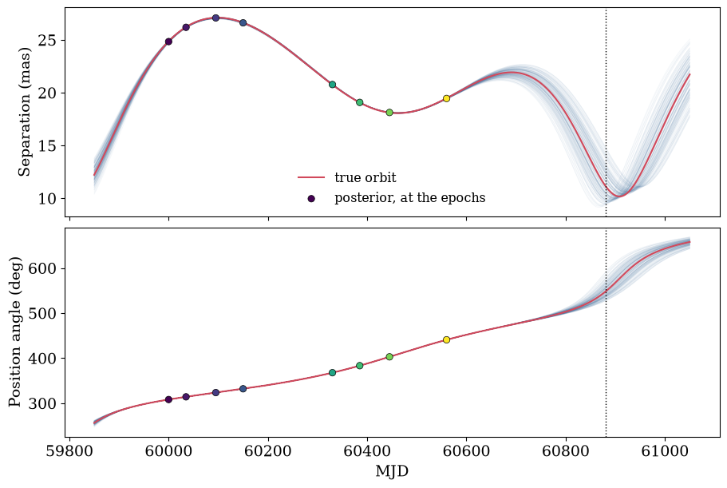
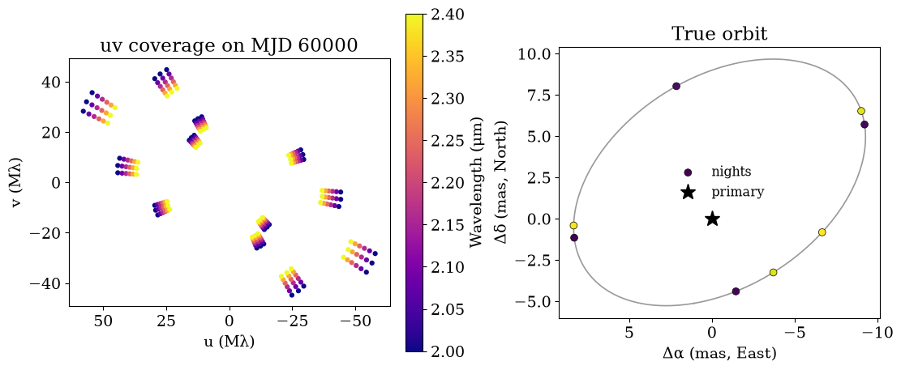
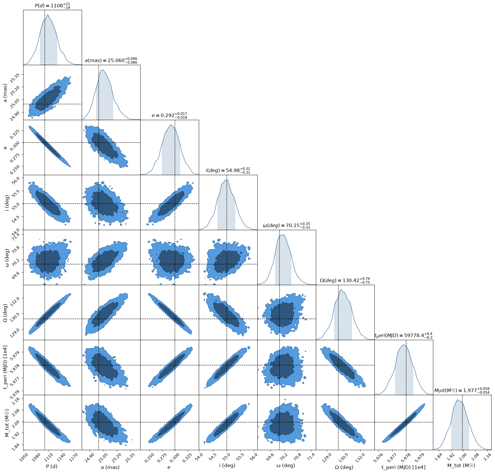

<!-- AUTO-GENERATED FROM notebooks/orbit_fitting.ipynb by scripts/sync_tutorial_docs.py. -->
# Fitting a binary's orbit to interferometric data

!!! warning "Provisional"
    May change in any 0.4.x release without a deprecation cycle.

> **Install:** this tutorial needs the `orbits`, `plots` and `pipeline` extras: `pip install "virgil-astro[orbits,plots,pipeline]"`.

**Status.** The thresholds behind the alias, no-orbit, label-swap and resolved-primary verdicts are in nats and are not yet calibrated against a null distribution, so read them as indications and not as Bayes factors. Tempering, the short-arc search and the night-outlier mixture are virgil's own designs without a published source; tempering is opt-in until 0.5 (`temper=True`; the default is untempered); its check currently warns outside a fixed range of the factor, 0.5 to 2.

A resolved binary observed again over weeks and years shows the companion moving around its primary. `OrbitPipeline` turns a set of OIFITS files, one or more per night, into a Keplerian orbit **without being told the period**. The nights are often far apart, so many orbit counts fit the positions almost equally well (period aliases), and the pipeline's job is to weigh them with all the interferometric data and sample the survivor. No published period, window, starting orbit or prior is used anywhere: a published orbit may be compared with the result afterwards, never fed into the fit.

**What you'll get.** One call, a run folder, and the orbit recovered from two observing seasons 238 days apart for a binary with a 12.4 day period:



*Orbits drawn from the posterior (blue) around the true orbit (red). The markers are the companion's positions at the eight nights, fitted from each night alone, coloured by time.*

The page has four parts:

1. **Simulate** eight nights of VLTI-like data whose quoted errors are too small by a different factor each night, as real ones are, and write them as OIFITS files.
2. **One call**: `OrbitPipeline.from_oifits(files).run()`, then read the result: the raw χ²/N, the quality checks, the orbit and the alias bands.
3. **The engine underneath**: the functions the pipeline calls (`epoch_positions`, `fit_orbit_aliases`, tempering), for when you need control.
4. **How the engine decides**, and why its defaults are what they are.

`OrbitPipeline` fits data that an instrument package has already prepared: the channel, band edges, outlier exposures and noise model are the instrument package's job (for the VLTI instruments, [virgil-vlti](https://github.com/benjaminpope/virgil-vlti)), not the pipeline's. It has no instrument-specific settings, so this page applies to any instrument. The orbit conventions are those of [Conventions](conventions.md#orbits): `Omega` is the position angle of the node where the secondary recedes, `omega` is the secondary's argument of periastron, an inclination below 90° means the position angle increases with time, and times are days since a reference epoch `t_ref`.

## The system

The binary has a period of 12.38 days, a mildly eccentric orbit ($e = 0.3$), a semimajor axis of 10 mas and an inclination of 50°; the companion is 0.3 times as bright as the primary in the K band. It is observed on eight nights in two seasons, four nights early in 2023 and four about 238 days later. Between the seasons the companion completes about twenty orbits, so the period is aliased: the positions of the second season fit every period whose cycle count differs from the true one by a whole number. Each night has three snapshots 30 minutes apart, so the companion is a static point within a night to good accuracy, as the pipeline assumes.

This is one simulated realization, on the geometry the search was developed on, and the seed is selected so that the quoted-error factors are recovered (see below). It shows what a run looks like, not how often a run recovers the orbit: no sweep over seeds has been run yet.

??? note "Imports and setup"

    ```python
    import warnings

    warnings.filterwarnings("ignore", message="IProgress not found.*")
    warnings.filterwarnings("ignore", category=SyntaxWarning)

    from pathlib import Path
    from tempfile import TemporaryDirectory

    import equinox as eqx
    import jax
    import matplotlib.pyplot as plt
    import numpy as np
    from IPython.display import Image

    from virgil.aliases import fit_orbit_aliases
    from virgil.coverage import vlti_oidata
    from virgil.epochs import epoch_positions
    from virgil.likelihood import whitened_residuals
    from virgil.models import Attached, PointSource, System
    from virgil.oifits import write_oifits
    from virgil.orbits import KeplerOrbit
    from virgil.pipeline import OrbitPipeline
    from virgil.plotting import plot_orbit_ensemble, set_style
    from virgil.simulate import simulate

    jax.config.update("jax_enable_x64", True)
    set_style()
    ```

```python
T_REF = 60000.0  # MJD of the reference epoch of the true orbit
FLUX = 0.3  # companion / primary
TRUTH = dict(
    period=12.38,
    dt_peri=2.0,
    ecc=0.3,
    inc=50.0,
    omega=60.0,
    Omega=120.0,
    a_mas=10.0,
)
truth_orbit = KeplerOrbit(**TRUTH, t_ref=T_REF)
NIGHTS = T_REF + np.array([0.0, 2.4, 5.1, 9.4, 238.0, 240.6, 247.4, 251.0])
N_EPOCHS = len(NIGHTS)

print(
    f"period {TRUTH['period']} d; the {np.ptp(NIGHTS):.0f} d between the "
    f"first and last night are {np.ptp(NIGHTS) / TRUTH['period']:.1f} orbits"
)
```

```text
period 12.38 d; the 251 d between the first and last night are 20.3 orbits
```

## Simulating the observations

[`vlti_oidata`](api/coverage.md) builds the coverage of the four 8-m Unit Telescopes at Paranal for a target at declination −30°: three snapshots per night, each with all six baselines and four closure triangles, in six K-band channels (2.0–2.4 μm). The quoted errors are 0.05 on each $V^2$ and 3° on each closure phase.

Real calibrated errors are usually too small, by a factor that changes from night to night with the seeing and the calibrators, and differently for $V^2$ and closure phases. We mimic this: each night's true scatter is its quoted error times a factor drawn from a log-normal population (median 1.3, spread 0.3 in the natural log), separately for $V^2$ and closure phases, while the data keep the quoted errors. The scene is a primary point source and a companion [`Attached`](api/models/index.md) to the true orbit, so [`simulate`](api/simulate.md) places the companion at the time of every sample.

```python
# The first seed from 0 whose true-model chi2/N is within two standard errors of
# (error factor)^2 on every night, for both V^2 and closure phases.
SEED = 0
rng = np.random.default_rng(SEED)
TRUE_V2_SCALE = 1.3 * np.exp(0.3 * rng.standard_normal(N_EPOCHS))
TRUE_CP_SCALE = 1.3 * np.exp(0.3 * rng.standard_normal(N_EPOCHS))

template = vlti_oidata(
    declination_deg=-30.0,
    hour_angles_h=(-0.5, 0.0, 0.5),
    wavelengths_m=np.linspace(2.0e-6, 2.4e-6, 6),
    sigma_v2=0.05,
    sigma_cp_deg=3.0,
    nights_mjd=NIGHTS,
)
truth_scene = System(
    primary=PointSource(), comp=Attached(PointSource(FLUX), truth_orbit)
)
keys = jax.random.split(jax.random.PRNGKey(SEED), 2 * N_EPOCHS)
nights = []
for k, night in enumerate(template.split_by_epoch()):
    v2 = simulate(truth_scene, night, keys[2 * k], TRUE_V2_SCALE[k])
    cp = simulate(truth_scene, night, keys[2 * k + 1], TRUE_CP_SCALE[k])
    nights.append(eqx.tree_at(lambda d: d.phi, v2, cp.phi))
print(
    f"{len(nights)} nights, each with {nights[0].vis.size} V² and "
    f"{nights[0].phi.size} closure phases ({nights[0].n_independent} "
    "independent observables)"
)
```

```text
8 nights, each with 108 V² and 72 closure phases (162 independent observables)
```

The quoted errors are too small, as the data show: the reduced χ² of the *true* model against each night's data, on the quoted errors, is close to the square of that night's error factor, for $V^2$ and closure phases alike. (The seed is the first from 0 for which this holds to within two standard errors on every night; a single draw can stray, since a night's $\chi^2_r$ scatters by about $\sqrt{2/\nu}$, with $\nu$ its independent observables.) This raw χ²/N is the first number to look at for any fit; a fit that rescaled the errors until χ² came out near 1 would hide the problem.

```python
print("   MJD    χ²_r V²  (true factor²)   χ²_r CP  (true factor²)")
for k, night in enumerate(nights):
    w = np.asarray(whitened_residuals(truth_scene, night))
    n_vis = night.vis.size
    n_cp = night.n_independent - n_vis
    chi2_v2 = np.sum(w[:n_vis] ** 2) / n_vis
    chi2_cp = np.sum(w[n_vis:] ** 2) / n_cp
    print(
        f"{NIGHTS[k]:8.1f}  {chi2_v2:6.2f}   ({TRUE_V2_SCALE[k] ** 2:5.2f})"
        f"         {chi2_cp:6.2f}   ({TRUE_CP_SCALE[k] ** 2:5.2f})"
    )
```

```text
   MJD    χ²_r V²  (true factor²)   χ²_r CP  (true factor²)
```

```text
 60000.0    1.66   ( 1.82)           1.23   ( 1.11)
 60002.4    1.69   ( 1.56)           0.66   ( 0.79)
 60005.1    2.22   ( 2.48)           1.51   ( 1.16)
 60009.4    1.65   ( 1.80)           1.87   ( 1.73)
 60238.0    1.07   ( 1.23)           0.49   ( 0.42)
 60240.6    2.06   ( 2.10)           1.36   ( 1.48)
 60247.4    4.24   ( 3.70)           0.85   ( 0.80)
 60251.0    3.51   ( 2.98)           1.16   ( 1.09)
```

The left panel shows the uv coverage of the first night, coloured by wavelength. The right panel shows the true orbit on the sky (East to the left, North up) with the companion at each night, coloured by season.

```python
fig, (ax_uv, ax_sky) = plt.subplots(
    1, 2, figsize=(11, 4.6), constrained_layout=True
)
first = nights[0]
uu, vv = (np.asarray(x / first.wavel) / 1e6 for x in (first.u, first.v))
wavel_um = np.asarray(first.wavel) * 1e6
for sign in (1, -1):
    points = ax_uv.scatter(
        sign * uu, sign * vv, c=wavel_um, cmap="plasma", s=12
    )
fig.colorbar(points, ax=ax_uv, label="Wavelength (μm)")
ax_uv.set(
    xlabel="u (Mλ)",
    ylabel="v (Mλ)",
    aspect="equal",
    title=f"uv coverage on MJD {NIGHTS[0]:.0f}",
)
ax_uv.invert_xaxis()  # East to the left

track = T_REF + TRUTH["dt_peri"] + np.linspace(0, TRUTH["period"], 400)
dra, ddec, _ = truth_orbit.relative(track)
night_dra, night_ddec, _ = truth_orbit.relative(NIGHTS)
ax_sky.plot(dra, ddec, color="0.6", lw=1.2)
ax_sky.scatter(
    night_dra,
    night_ddec,
    c=NIGHTS,
    cmap="viridis",
    s=40,
    edgecolors="k",
    linewidths=0.5,
    zorder=3,
    label="nights",
)
ax_sky.plot(0, 0, "*", color="k", ms=14, label="primary")
ax_sky.set(
    xlabel="Δα (mas, East)",
    ylabel="Δδ (mas, North)",
    aspect="equal",
    title="True orbit",
)
ax_sky.invert_xaxis()
ax_sky.legend(frameon=False, fontsize="small")
plt.show()
```



## One call

Your data are OIFITS files, so we write the simulated nights to a temporary folder as one file per night. (This is only here because the simulated nights start as `OIData`; real files come from your instrument package.)

??? note "Code"

    ```python
    folder = TemporaryDirectory()
    files = []
    for k, night in enumerate(nights):
        files.append(str(Path(folder.name) / f"night{k}.oifits"))
        write_oifits(night, files[-1])
    print(f"wrote {len(files)} OIFITS files")
    ```

```text
wrote 8 OIFITS files
```

`OrbitPipeline.from_oifits` reads the files and groups them into nights at gaps of `gap_days` (half a day by default; override a file's night, or its time stamp, with `metadata`). Everything else has a default. The only settings below shorten the sampler, which by default is 4 chains of 1000 warm-up and 1000 draws, and skip the executed quicklook notebook, so the page stays quick:

```python
RUN = Path(folder.name) / "run"
pipeline = OrbitPipeline.from_oifits(
    files,
    output=RUN,
    num_warmup=500,
    num_samples=500,
    num_chains=2,
    quicklook_execute=False,
    temper=True,  # opt-in until 0.5; the default is untempered
)
res = pipeline.run()
print(res.describe())
```

```text
OrbitPipeline run in /var/folders/19/fbthdtcx20d3xyc7y7vp_2v40000gn/T/tmpkby6gd0q/run: complete
  data.n_nights = 8
  data.n_datasets = 8
  data.n_vis = 864
  data.n_phi = 576
  data.n_independent = 1296
  data.span_days = 251
  data.wavel_min_m = 2e-06
  data.wavel_max_m = 2.4e-06
  data.baseline_min_m = 46.1298
  data.baseline_max_m = 130.092
  data.resolution_mas = 1.58553
  data.fov_mas = 10.7314
  chi2.n_independent = 1296
  chi2.best_orbit_reduced = 1.87211
  search.n_bands = 1
  search.t_ref = 60124.2
  search.span_days = 251
  search.primary_diam_estimate = 0
  orbit.n = 20
  posterior.num_chains = 2
  posterior.num_samples = 500
  posterior.num_warmup = 500
  posterior.r_hat_max = 1.00134
  posterior.ess_bulk_min = 495.583
  posterior.divergence_fraction = 0
  posterior.optimum_gap_max = 0
  [pass] chi2: χ²/N = 1.87 for the best-fit orbit on quoted errors: consistent with the quoted errors.
  [pass] night_flags: None of the 8 nights is flagged.
  [pass] labels_free: The labels of the stars are determined by the data.
  [pass] bands_failed: Every alias band was evaluated.
  [pass] alias_ambiguity: There is a single alias band: no rival period.
  [pass] winner_flags: The winning band's evidence has no flags.
  [warn] tempering: The effective-channel factor f = 1.31 (raw 1.18) is outside [0.5, 2] or the residual correlation is not AR(1): the evidences are less reliable.
  [pass] primary_resolved: The primary's size is not at the edge of the diameters tried.
  [pass] no_orbit: The best orbit beats a single star by 1.4e+03 nats: the orbit is clearly preferred.
  [pass] period_bound: The period is inside its window (1.37 to 1e+03 d).
  [pass] prior_bound: No posterior mass piles up at a prior bound.
  [pass] r_hat: Largest R-hat 1.0013: the chains agree.
  [pass] ess: Smallest bulk ESS 496: enough independent samples.
  [pass] divergences: Divergent transitions: 0 per cent: none.
  [pass] mode_converged: The search's best mode is an optimum of the sampled density.
  [warn] stage_warnings: 2 warning(s) were raised inside the stages: fit_orbit_aliases(): the period window starts at 1.37 d, 6.9 nights' length: a shorter period would move the companion by more than half the resolution during a night (field 8.33 mas). Pass p_range to search shorter periods.; fit_orbit_aliases(): the residual correlation of ['phi'] is flat across channels (lag-2 well above the square of lag-1), the signature of a shared calibration error or of misfit (a resolved primary, a moving companion). The likelihood is tempered by it either way; check the model (AliasResult.tempering).. See the 'warnings' list of summary.json.
  2 warning(s) recorded in the search stage(s) (see the checks, or Result.summary['warnings'])
```

## Reading the result

`describe()` prints the key numbers, led by the raw χ²/N of the best orbit on the quoted errors, and then the quality checks, in a fixed order, each with a status and a message. The summary is also a plain dictionary (`res.summary`, the file `summary.json` in the run folder) that a script or an agent can read without rerunning anything. First, the χ²/N of the best orbit on the quoted errors, night by night, against the truth we know here:

```python
chi2 = res.summary["chi2"]
print(
    f"best orbit: χ²/N = {chi2['best_orbit_reduced']:.2f} on the quoted "
    f"errors, N = {chi2['n_independent']}"
)
print("night       χ²/N   (true model)")
for (name, row), night in zip(chi2["nights"].items(), nights):
    w = np.asarray(whitened_residuals(truth_scene, night))
    true_chi2 = np.sum(w**2) / night.n_independent
    print(f"{name:9s} {row['chi2_per_n']:6.2f}   ({true_chi2:6.2f})")
```

```text
best orbit: χ²/N = 1.87 on the quoted errors, N = 1296
night       χ²/N   (true model)
mjd60000    1.48   (  1.52)
mjd60002    1.35   (  1.35)
mjd60005    1.97   (  1.99)
mjd60009    1.71   (  1.72)
mjd60238    0.81   (  0.88)
mjd60240    1.82   (  1.82)
mjd60247    3.13   (  3.11)
mjd60251    2.70   (  2.73)
```

A χ²/N of 1.87 passes the `chi2` check, which warns above 2 and fails above 5, yet the quoted errors here are too small by about $\sqrt{1.9}\approx1.4$, as simulated; the scale-marginalized score the engine fits absorbs that factor, and the raw χ²/N is how you see it. The checks say how far to trust the result. A check passes, warns or fails; none is silent about a problem, and `res.summary["worst_check"]` gives the worst status. Those that matter most for an orbit:

- `chi2`: the raw χ²/N of the best orbit.
- `night_flags`: nights that carry a flag. A blocking flag keeps a night from seeding an orbit; a non-blocking one (such as `sep-below-resolution`) is only reported. The data still count either way.
- `alias_ambiguity`: the log evidence of the best alias band over the runner-up's, in nats; under 10 nats the runner-up is not excluded. The 10 nats is not calibrated.
- `tempering`: the correlated-channel factor of the likelihood is outside what it can trust.
- `no_orbit`: the best orbit against a single star, as a difference in log evidence in nats. It is not a calibrated Bayes factor, and its threshold (`no_orbit_nats`, 10) is not yet calibrated against a null distribution.
- `r_hat`, `ess`, `divergences`: the sampler.

```python
for check in res.checks:
    print(f"[{check.status:4s}] {check.name:16s} {check.message[:100]}")
```

```text
[pass] chi2             χ²/N = 1.87 for the best-fit orbit on quoted errors: consistent with the quoted errors.
[pass] night_flags      None of the 8 nights is flagged.
[pass] labels_free      The labels of the stars are determined by the data.
[pass] bands_failed     Every alias band was evaluated.
[pass] alias_ambiguity  There is a single alias band: no rival period.
[pass] winner_flags     The winning band's evidence has no flags.
[warn] tempering        The effective-channel factor f = 1.31 (raw 1.18) is outside [0.5, 2] or the residual correlation is 
[pass] primary_resolved The primary's size is not at the edge of the diameters tried.
[pass] no_orbit         The best orbit beats a single star by 1.4e+03 nats: the orbit is clearly preferred.
[pass] period_bound     The period is inside its window (1.37 to 1e+03 d).
[pass] prior_bound      No posterior mass piles up at a prior bound.
[pass] r_hat            Largest R-hat 1.0013: the chains agree.
[pass] ess              Smallest bulk ESS 496: enough independent samples.
[pass] divergences      Divergent transitions: 0 per cent: none.
[pass] mode_converged   The search's best mode is an optimum of the sampled density.
[warn] stage_warnings   2 warning(s) were raised inside the stages: fit_orbit_aliases(): the period window starts at 1.37 d,
```

Two checks warn. The first, `stage_warnings`, has the search say how it chose its shortest period: a night is treated as a static snapshot, so periods short enough for the companion to move by more than half the resolution within a night are not searched (the window's lower end, 1.4 days here, is computed from the data; pass `period_range` to override it). The 12.4 day period is well inside the window. The second, `tempering`, is the search noticing that the residual closure-phase correlation across channels is flat, which can mean a shared calibration error or a misfit; the effective-channel factor $f = 1.31$ is itself inside its range. Here the data have no shared calibration error, but their error factors differ by a factor of two between nights and the companion moves during a night's three snapshots, which the per-night static position does not model, and either can look like one. It matters for how far to trust differences of evidence between alias bands; with one band here, the choice between bands is not at stake.

The winner's orbital elements come with 68% intervals from the posterior. The time of periastron is defined modulo the period, so we compare the passage nearest the true one.

```python
t_ref = res.summary["search"]["t_ref"]
elements = res.summary["orbit"]["elements"]
truth_t_peri = T_REF + TRUTH["dt_peri"]
t_peri = t_ref + elements["dt_peri"]["median"]
period = elements["period"]["median"]
wrap = (t_peri - truth_t_peri + period / 2) % period - period / 2
truths = {**TRUTH, "flux": FLUX, "dt_peri": TRUTH["dt_peri"] - wrap}
print(f"{'':8s}{'median':>12s}   68% interval            truth")
for name in ("period", "a_mas", "ecc", "inc", "omega", "Omega", "flux"):
    row = elements[name]
    print(
        f"{name:8s}{row['median']:12.4f}   "
        f"[{row['q16']:.4f}, {row['q84']:.4f}]   {truths[name]:10.4f}"
    )
q16, q84 = (elements["dt_peri"][k] - elements["dt_peri"]["median"] for k in ("q16", "q84"))
t_peri_near = truth_t_peri + wrap
print(
    f"{'t_peri':8s}{t_peri_near:12.3f}   "
    f"[{t_peri_near + q16:.3f}, {t_peri_near + q84:.3f}]   {truth_t_peri:10.3f}"
)
```

```text
              median   68% interval            truth
period       12.3799   [12.3797, 12.3801]      12.3800
a_mas        10.0081   [9.9869, 10.0277]      10.0000
ecc           0.2993   [0.2984, 0.3001]       0.3000
inc          49.9089   [49.7860, 50.0232]      50.0000
omega        59.8514   [59.6021, 60.1667]      60.0000
Omega       120.0860   [119.8990, 120.2714]     120.0000
flux          0.2999   [0.2978, 0.3020]       0.3000
t_peri     60001.997   [60001.994, 60002.001]    60002.000
```

A period of 12.38 days was found blind. The alias table shows what the search did: it lists one row per alias band, an integer number of orbits between the two seasons, with the band's log evidence, its probability and its flags. Here the short-arc step (see [short arcs](orbit_methods.md#short-arcs)) rejected every other cycle count from the motion within and between the nights of each season before any band was fitted, so one band is left. With sparser nights several bands survive, and `alias_ambiguity` reports their margin.

```python
aliases = res.aliases()  # the engine's AliasResult, read back from the folder
print("band    n   period (d)  χ²/N     log Z     p  flags")
for row in aliases.table():
    print(
        f"{row['n']:11d} {row['period']:11.4f} {row['chi2_red']:6.2f} "
        f"{row['log_z']:9.1f} {row['p']:5.2f}  {row['flags']}"
    )
arcs = aliases.short_arc
print(
    f"the short arcs kept N = {arcs['kept']} and excluded "
    f"{len(arcs['excluded'])} other cycle counts"
)
```

```text
band    n   period (d)  χ²/N     log Z     p  flags
         20     12.3799   1.87   -2571.9  1.00  []
the short arcs kept N = [20] and excluded 183 other cycle counts
```

The run folder holds everything else. The posterior corner plot and the alias-band plot are written there, and every number in the summary comes from a public virgil function that you can call yourself (next section).

```python
plots = {Path(p).stem: p for p in res.plots}
print(sorted(plots))
Image(plots["search_bands"])
```

```text
['modes_sky', 'posterior_corner', 'posterior_trace', 'search_bands']
```


```python
Image(plots["posterior_corner"])
```



### The run folder and the command line

The run folder is the pipeline's output: `run.json` records the settings, the hash of every input file and the night it was assigned to, `summary.json` the numbers and checks, `stages/<name>/report.json` each stage, `samples.h5` the posterior, `plots/` the figures and `quicklook.ipynb` an executed notebook. An interrupted run resumes, refitting only the alias bands that are missing, and a changed setting or input file raises `ConfigMismatchError` rather than mixing old and new results. A later session reads a finished run without recomputing anything:

```python
res = load("runs/target")
res.summary["modes"]["winner"]     # the winning band
res.aliases().table()              # every band
res.samples()["period"]            # posterior draws, shape (chain, draw)
```

The same run from a shell: `virgil-pipeline orbit night*.oifits --output runs/target`, with `--set KEY=VALUE` for a setting and `--metadata FILE.json` for per-file rulings. The [pipelines page](pipeline.md#orbitpipeline-a-binary-seen-on-several-nights-provisional) lists the stages, settings and checks.

## The engine underneath

`OrbitPipeline` adds no science of its own. Its stages call public functions that you can call directly, with every argument open, when the pipeline's defaults are not what you need:

| Stage | The function it calls |
| --- | --- |
| `epochs` | [`epoch_positions`](api/epochs.md): each night's companion position on a grid, with the night's flags |
| `search` | [`fit_orbit_aliases`](api/aliases.md): the alias search, with the period window from the data, the label swap, flux flip, V² amplitude, primary diameter and tempering |
| `modes` | the best band against the others (`AliasResult`) and against a single star |
| `posterior` | NUTS on the engine's own density, in the winning band |

**Nightly positions and flags.** `epoch_positions` fits each night by a static binary on a grid of positions. The pipeline widens the grid until no night's best peak sits at its edge; here a fixed box is enough. Each night is scored with its error scales integrated out, so its `gap_marginal` (the best peak over every rival, in nats) does not depend on how well the quoted errors are calibrated. A night that cannot seed an orbit is flagged, with its reason, and still counts in every band's likelihood.

```python
epochs = pipeline.data  # the nights as an Epochs object
axis = np.linspace(-20.0, 20.0, 161)
found = epoch_positions(
    epochs,
    {"dra": axis, "ddec": axis, "flux": np.geomspace(0.05, 1.0, 13)},
)
true_dra, true_ddec, _ = (np.asarray(x) for x in truth_orbit.relative(epochs.times))
print("    MJD    fit Δα  true Δα    fit Δδ  true Δδ  flux  gap_marginal  flags")
for k, t in enumerate(epochs.times):
    print(
        f"{t:8.1f}  {found.dra[k]:7.2f}  {true_dra[k]:7.2f}"
        f"   {found.ddec[k]:7.2f}  {true_ddec[k]:7.2f}"
        f"  {found.flux[k]:.2f}  {found.gap_marginal[k]:9.0f}"
        f"       {[f.code for f in found.flags[k]]}"
    )
```

```text
    MJD    fit Δα  true Δα    fit Δδ  true Δδ  flux  gap_marginal  flags
 60000.0     8.32     8.32     -1.24    -1.15  0.30        142       []
 60002.4    -1.43    -1.45     -4.43    -4.40  0.28         93       []
 60005.1    -9.25    -9.23      5.69     5.70  0.30        126       []
 60009.4     2.14     2.15      8.00     8.02  0.28         89       []
 60238.0    -3.75    -3.72     -3.25    -3.26  0.30        159       []
 60240.6    -9.03    -9.03      6.54     6.52  0.30        132       []
 60247.4     8.36     8.36     -0.39    -0.41  0.30        112       []
 60251.0    -6.68    -6.67     -0.82    -0.82  0.30        128       []
```

**The alias search.** `fit_orbit_aliases` takes the nights and, with no period window, derives it from the data. The call below is the pipeline's `search` stage with the default settings: nothing is passed but the data, the night times and the positions that seed the fits.

```python
result = fit_orbit_aliases(
    list(epochs.data), None, positions=found, times=epochs.times, temper=True
)
best = result.best
print(
    f"{len(result.bands)} band(s); the best has N = {best.n}, "
    f"P = {best.best['period']:.4f} d, log Z = {best.log_z:.1f}"
)
print(
    "same winner and elements as the pipeline:",
    best.n == aliases.best.n
    and abs(best.best["period"] - aliases.best.best["period"]) < 1e-2,
)
```

```text
UserWarning: fit_orbit_aliases(): the period window starts at 1.37 d, 6.9 nights' length: a shorter period would move the companion by more than half the resolution during a night (field 8.33 mas). Pass p_range to search shorter periods.
```

```text
UserWarning: fit_orbit_aliases(): the residual correlation of ['phi'] is flat across channels (lag-2 well above the square of lag-1), the signature of a shared calibration error or of misfit (a resolved primary, a moving companion). The likelihood is tempered by it either way; check the model (AliasResult.tempering).
```

```text
1 band(s); the best has N = 20, P = 12.3799 d, log Z = -2571.9
same winner and elements as the pipeline: True
```

**Tempering.** The six channels of a night share one atmosphere and one calibration, so their errors are correlated, and a likelihood that counts them as independent is overconfident. The engine estimates an effective-channel factor $f$ from the residuals of the best fit ([`virgil.tempering`](api/tempering.md)) and divides every difference of log evidence by it; `AliasResult.tempering` is true when $f$ is outside the range the correction can trust (above 2, or a flat residual correlation that is a sign of a shared error or a misfit rather than of noise). The pipeline's `tempering` check reports the same flag.

```python
print(f"effective-channel factor f = {result.temper_f:.2f} (raw {result.temper_f_raw:.2f})")
print("per block:", {k: round(v, 2) for k, v in (result.temper_blocks or {}).items()})
print("outside the range the correction can trust:", result.tempering)
```

```text
effective-channel factor f = 1.31 (raw 1.18)
per block: {'phi': 1.64, 'vis': 1.18}
outside the range the correction can trust: True
```

**Control.** Every default is a keyword. The ones most often changed are `period_range`, `a_range`, `flux_range`, `ecc_max`, `primary_diam`, `gap_days` and `exclude`; the [`OrbitPipeline` settings](pipeline.md#orbitpipeline-settings) table lists them all, and [Orbit methods](orbit_methods.md#alias-settings) says what the search settings do and why their defaults are what they are. A model that is not a point companion on a Keplerian orbit is fitted by building it yourself: [`Epochs`](api/epochs.md) gives the data and noise terms for [`numpyro_model`](api/likelihood.md), the [hierarchical inference](hierarchical_inference.md) page shows per-epoch error scales drawn from a population, and the [orbit worked example](https://github.com/benjaminpope/virgil/blob/main/notebooks/mwe/mwe_orbit.ipynb) attaches a disc to the companion. [Which orbit tool?](which_orbit_tool.md) is the decision tree.

## The orbit on the sky

We draw 150 orbits from the posterior and plot them with [`plot_orbit_ensemble`](api/plotting.md), with the primary at the origin and the true orbit in red. The markers are the companion's position on each night, fitted from that night's data alone, as above.

```python
draws = {k: np.asarray(v).reshape(-1) for k, v in res.samples().items()}
pick = np.random.default_rng(7).choice(draws["period"].size, 150, replace=False)
ensemble = KeplerOrbit(
    **{
        k: v[pick]
        for k, v in draws.items()
        if k in ("period", "dt_peri", "ecc", "inc", "omega", "Omega", "a_mas")
    },
    t_ref=t_ref,
)
fig, ax = plot_orbit_ensemble(
    ensemble, found.positions(t_ref=t_ref, skip_flagged=False), truth_orbit
)
ax.set_title("OrbitPipeline: 150 posterior orbits and the nightly positions")
plt.show()
```


## Summary

We simulated eight nights of VLTI-like squared visibilities and closure phases of a 12.4 day binary, in two seasons 238 days apart, with nightly errors that are wrong by different amounts. One call, `OrbitPipeline.from_oifits(files).run()`, found the period blind (no window, start or prior), flagged nothing it should not, reported the raw χ²/N on the quoted errors first, and sampled the orbit; the engine functions it calls gave the same answer.

For real data:

- **Prepare the data with the instrument package.** The pipeline does not select channels, trim bands, screen exposures or model noise; those depend on the instrument. Check the raw χ²/N of the best orbit (the `chi2` check) before anything else: a rescaled χ²/N of 1 says nothing about the fit.
- **Read the checks, in order.** `night_flags` and `labels_free` say what the data cannot decide; `alias_ambiguity` says whether another cycle count is excluded (under 10 nats it is not); `tempering` says whether the channels' correlation is beyond the correction.
- **Compare with a published orbit last.** Published information may be compared with the result in the sky plane (Thiele–Innes constants), never fed into the fit.
- **Run it where it is fast.** The search and the sampler evaluate every night at every step; on real data with many frames and channels, use a cluster CPU or a GPU.

Where to go next: [Pipeline reference](pipeline.md) for the run folder and the checks, [Orbit methods](orbit_methods.md) for the scoring, the night flags and the alias search, [Binary search](binary_search.md) for the single-epoch grid and sampler, and [Which orbit tool?](which_orbit_tool.md) for the alternatives.
