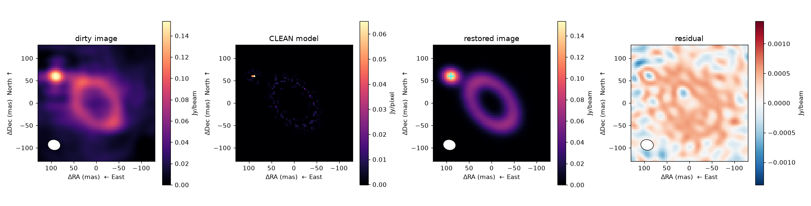
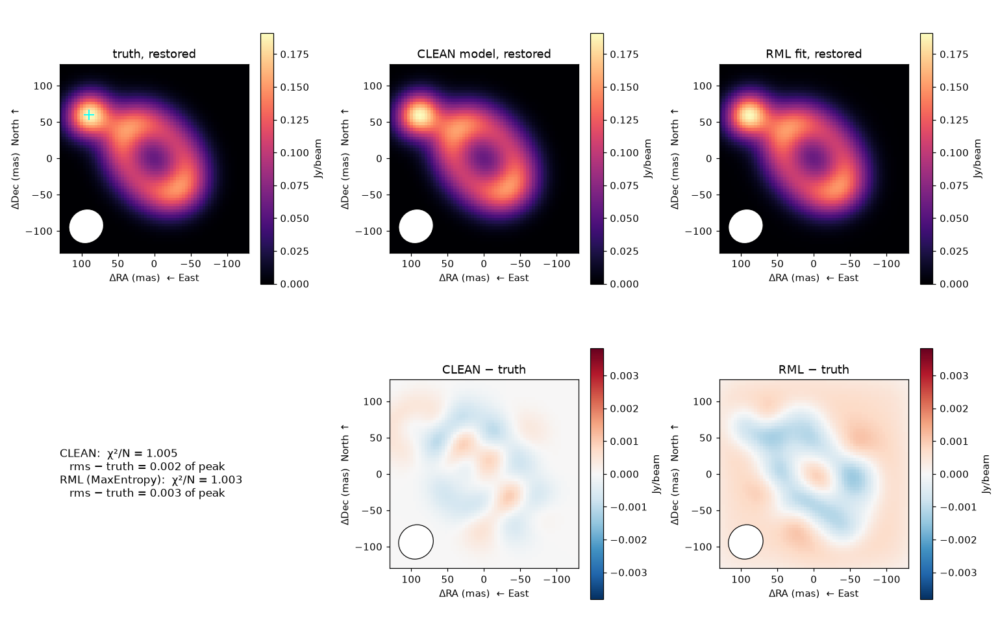

# CLEAN for radio visibilities

!!! warning "Provisional"
    May change in any 0.4.x release without a deprecation cycle.

[`virgil.radio_clean.clean`](api/radio_clean.md) deconvolves calibrated complex
visibilities ([`ComplexVisData`](radio_interferometry.md)) the way radio
astronomers expect: Cotton–Schwab major cycles against the exact visibility
residual, Högbom or multi-scale minor cycles, natural, uniform or Briggs
weighting with a `uvtaper`, a restoring beam fitted to the PSF, and FITS products
with the headers `tclean` writes. It claims no parity with CASA or WSClean:
the algorithms are the published ones.

## Example: a simulated ring

The scene is the one of the [radio imaging tutorial](radio_tutorial.md): an inclined ring of
0.8 Jy with a compact 0.2 Jy clump to its north-east (the `+` marks the clump), observed by 300
random baselines over six hours, with noise. `scripts/make_radio_docs_figures.py` makes every
figure on this page in about a minute on a laptop CPU.

??? note "Simulation"

    ```python
    import jax
    import numpy as onp

    from virgil import ComplexVisData, scenes
    from virgil._geometry import image_visibilities

    jax.config.update("jax_enable_x64", True)
    N, S, SIG = 65, 4.0, 0.05  # pixels, mas per pixel, Jy per real/imaginary part
    truth = onp.asarray(0.8 * scenes.ring(N, S, 60, 10, inc_deg=50, pa_deg=40) + 0.2 * scenes.gaussian_blob(N, S, 6, dra=90, ddec=60))
    rng = onp.random.default_rng(1)
    bl = onp.exp(rng.uniform(onp.log(100), onp.log(1e4), (300, 2))) * rng.choice([-1, 1], (300, 2))  # east, north (m)
    H, dec, lat = onp.deg2rad(onp.linspace(-45, 45, 200)), onp.deg2rad(-37), onp.deg2rad(-23)
    u = ((bl[:, :1] * onp.cos(H) - bl[:, 1:] * onp.sin(lat) * onp.sin(H)) / 1.3e-3).ravel()
    v = ((bl[:, :1] * onp.sin(dec) * onp.sin(H) + bl[:, 1:] * (onp.sin(lat) * onp.sin(dec) * onp.cos(H) + onp.cos(lat) * onp.cos(dec))) / 1.3e-3).ravel()
    vis = onp.asarray(image_visibilities(truth, u, v, S, ft="dft")) + SIG * (rng.normal(size=u.size) + 1j * rng.normal(size=u.size))
    data = ComplexVisData.from_arrays(u, v, vis, 1 / SIG**2, 230e9)  # u, v in wavelengths; weight = 1/σ²
    ```

```python
from virgil.radio_clean import clean

sigma = 1 / onp.sqrt(onp.sum(onp.asarray(data.weight)))  # thermal noise of the natural image
res = clean(data, npix=65, pixel_scale_mas=4.0, deconvolver="hogbom", weighting="briggs", robust=0.5,
            threshold=3 * sigma, usemask="auto-multithresh")
res.image, res.model, res.residual   # Jy/beam, Jy/pixel, Jy/beam
model_vis = res.model_visibilities(data)   # the model at the data's (u, v)
```



The dirty image is the data convolved with the dirty beam. CLEAN replaces it by a sparse model
(second panel); restored through the Gaussian beam (white ellipse), the model plus residual
gives the third. The residual is on a symmetric scale centred on zero, at a small fraction of
the peak. Every sky image on this page has North up and East left.

**CLEAN against RML.** The same data, fitted instead as a pixel `Image` with a `MaxEntropy`
regularizer ([tutorial](radio_tutorial.md)), both seen through the CLEAN beam, with their
difference from the truth on one scale:



Both reach χ²/N ≈ 1 on the quoted errors, and both differ from the truth by about 0.2 per
cent of its peak. CLEAN is a greedy sparse model that needs no optimizer and no prior; the
fit is a nonlinear optimization with a prior, which is what lets it carry constraints beyond
the data (positivity, a regularizer, nuisance parameters). On this scene, one seed, neither
is more accurate: the choice is one of workflow.

!!! note "Real data"
    For a real ALMA continuum image the call has the same shape, with a multi-scale deconvolver and a
    taper, for example
    `clean(data, npix=1025, pixel_scale_mas=3.0, deconvolver="multiscale",
    scales_mas=[0, 30, 150, 450], weighting="briggs", robust=0.5, uvtaper=(33, 26, 137.5),
    niter=50000, threshold=5e-5, nsigma=3, usemask="auto-multithresh")`,
    followed by `res.write_fits("name", ra_deg=..., dec_deg=..., freq_hz=...)`.

## How it works

Each **major cycle** forms the residual visibilities `V − M`, with `M` the
NUFFT of the current model image (`nufftax`, in chunks), and grids them by the
adjoint NUFFT into a dirty image in Jy/beam (so a point source of flux `F`
peaks at `F`). No gridding of the data is done. Each **minor cycle** works
on that residual image alone: it finds the peak, adds `gain` times it as a
component, and subtracts the PSF there, in a window of `psfpatch` pixels
(Clark 1980), until the peak falls below the *cycle threshold*

```
max(threshold, nsigma × rms,  f × peak),   f = clip(cyclefactor × sidelobe,
                                                    minpsffraction, maxpsffraction)
```

(`sidelobe` is the PSF's highest sidelobe outside the main lobe), or
`cycleniter` iterations. The sidelobes the window left out are removed by the
next major cycle, which recomputes the residual exactly (Schwab 1984).
The minor cycle's PSF is computed out to `psfpatch` pixels (at most `npix - 1`,
as a component near one edge needs the PSF out to the opposite edge), not just
on the image grid; where that reach is capped at `npix - 1`, the tails of the
largest multiscale kernels are truncated slightly near the corners. The
loop ends at `threshold`, `nsigma`, `niter`, `time_limit` or `diverged`;
`RadioCleanResult.stop` says which. As in `tclean`, a minor cycle ends early
if its peak rises 10 per cent above its running minimum (per scale; the
`minor_stop` of each `history` entry says why it ended), and the run stops
(`"diverged"`) if the whole-image peak residual grows by more than 3.0,
relative, over the previous major cycle or the minimum so far.

**Multi-scale** (Cornwell 2008): the components are Gaussians of the given
`scales_mas` (FWHM in mas; 0 is a point). At each iteration the scale and
position with the largest `D_s / √H_ss` (the decrease in χ² of a component, `D_s`
the residual smoothed to the scale, `H_ss` the smoothed PSF's peak), weighted by
CASA's small-scale bias `1 − smallscalebias · s/s_max`, is chosen. Cross terms
between scales are the PSF convolved with one Gaussian of the summed variance.
`deconvolver="hogbom"` is the single scale 0, i.e. Högbom's (1974) CLEAN
(every minor cycle here is Clark's windowed one, so there is no `"clark"`
option). `scales_mas` are in mas, as in `imaging.clean`; `npix` must be odd.

**Weighting.** Briggs and uniform densities are counted on a uv grid of cell
`1/FoV` (`uv_cell`), with Hermitian partners together. `uvtaper` multiplies the
weights by the Fourier transform of an image-plane Gaussian of FWHM
`(bmaj, bmin, pa)` in mas (a number is circular), after the density, and the
PSF is renormalized to peak 1; the beam widens roughly as `√(b² + t²)`.

**Restoring beam.** The Gaussian fitted to the PSF's main lobe above
`psfcutoff` (0.35 in CASA); the restored image is the model (Jy/pixel)
convolved with it, plus the residual. With a user `restoringbeam` the residual
is left in dirty-beam Jy/beam, not rescaled to the new beam's area, as CASA does.

**Masks.** `mask` is a boolean array (True where components may be placed).
`usemask="auto-multithresh"` adds, every major cycle, regions of the
beam-smoothed residual: connected above `lownoisethreshold × rms` and
containing a pixel above `noisethreshold × rms` or `sidelobethreshold ×
sidelobe × peak`. It is a simplified version of CASA's (positive features only;
no negative or pruning thresholds).

**Primary beam.** CLEAN runs in the sky-times-beam plane, as `tclean` does with
`gridder="standard"`; `RadioCleanResult.pb_corrected(pb, pblimit)` divides the
restored image by a power beam, e.g. `exp(primary_beam(...))`.

## Relation to `tclean` and WSClean

| `virgil.radio_clean.clean` | `tclean` | WSClean |
| --- | --- | --- |
| `npix`, `pixel_scale_mas` | `imsize`, `cell` | `-size`, `-scale` |
| `deconvolver="hogbom"/"multiscale"` | `deconvolver` (also `mtmfs`) | `-multiscale` |
| `scales_mas` (mas; tclean's are pixels) | `scales` | `-multiscale-scales` |
| `smallscalebias` | `smallscalebias` | `-multiscale-scale-bias` |
| `weighting`, `robust` | `weighting`, `robust` | `-weight briggs R` |
| `uvtaper` | `uvtaper` | `-taper-gaussian` |
| `niter`, `gain` | `niter`, `gain` | `-niter`, `-gain` (minor), `-mgain` |
| `threshold` (Jy/beam) | `threshold` | `-threshold` |
| `nsigma` | `nsigma` | `-auto-threshold` |
| `cycleniter`, `cyclefactor`, `minpsffraction`, `maxpsffraction` | the same | `-mgain` |
| `psfpatch` | (the PSF patch) | no equivalent |
| `mask`; `usemask="auto-multithresh"` | `mask`; `usemask` | `-fits-mask`; `-auto-mask` |
| `restoringbeam`, `psfcutoff` | `restoringbeam`, `psfcutoff` | `-beam-size`, `-fit-beam` |
| `RadioCleanResult.model_visibilities` | `savemodel="modelcolumn"` | `-save-model` |
| `RadioCleanResult.write_fits` | `.image/.model/.residual/.psf` | `-name` products |
| `pb_corrected` | `pbcor`, `pblimit` | `-apply-primary-beam` |

Not implemented: `mtmfs` and multi-channel cubes (`specmode`), `gridder`
w-projection or mosaics, per-field masks from the primary beam, and
Stokes products other than the one in the data. The outputs are images of one
band, with the frequency written for reference only.

Differences from CASA that change a result: virgil images the data with the
adjoint NUFFT at the raw (u, v) points rather than grid-and-FFT with a
convolution kernel; the `nufftax` model transform has a finite tolerance
(`set_ft_defaults`); the auto-mask is simpler; and the restoring beam is fitted to a
PSF on a finite grid.

## Relation to `virgil.imaging.clean`

[`virgil.imaging.clean`](imaging_clean.md) is a different tool: a
gradient-based greedy sparse imager for optical interferometry (`OIData`),
which picks atoms by the gradient of the likelihood and refits their fluxes. It
cannot take complex visibilities and costs a Jacobian-vector product per
pixel, which is infeasible for tens of millions of radio visibilities. The
two share a name only, and `virgil.imaging.clean` is unchanged.

## References

Högbom (1974, A&AS 15, 417); Clark (1980, A&A 89, 377); Schwab (1984, AJ 89,
1076); Cornwell (2008, IEEE J. Sel. Top. Signal Process. 2, 793); Rau &
Cornwell (2011, A&A 532, A71); Offringa et al. (2014, MNRAS 444, 606); Briggs
(1995, PhD thesis); CASA `tclean` documentation.
